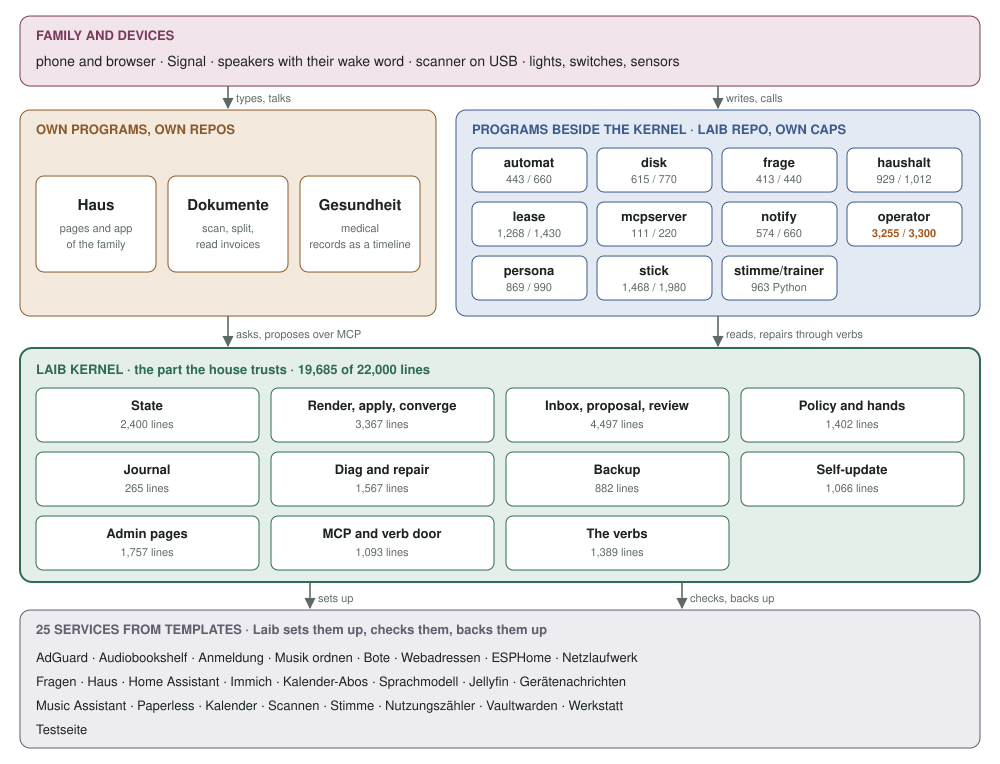

# Laib

**Laib** is the control plane for one home box, built for agents first and
humans second. The name carries the idea: the *Laib* is the daily loaf everyone
in the house takes a slice of; the *Leib* is the body of the house that agents
move as hands.

It replaces [ServiceBay](https://github.com/mdopp/servicebay) for this one box.
Nobody else runs it, so there is exactly one migration and no compatibility
layer (ADR 0010).

## What it is

- **A Git repo on the box is the only truth.** One folder per service, a
  `policy.yml`, a `box.yml`, an `age`-encrypted secrets file. Every change is a
  commit with an author, a reason and a diff. `git log` is the audit log.
- **One verb.** `laib plan` renders the state and shows the diff against the
  box; `laib apply` snapshots, writes, reloads, restarts and **verifies**. An
  apply whose verify is red is not a success.
- **systemd runs the containers**, not Laib. Laib renders Podman Quadlet files
  and reloads systemd. Restart policy and timers are systemd's; image updates
  are laib's own nightly run, verified, with the previous image back on red (#528).
- **The agent is the operator; Laib is its hands, memory and safety net.**
  Laib has no LLM code. The Operator, the box's admin agent, watches, looks
  inside containers, corrects and reports; the Bote talks with the family;
  the coding agents in the Werkstatt (pi,
  Claude Code) build what is missing. All speak the same CLI, exposed as
  MCP. Every action is journaled and reversible: snapshot before, verify
  after, rollback on red, a budget against loops. Only the irreversible
  waits for a human (ADR 0013).
- **Three human surfaces, one conversation.** The Bote is where you talk
  (Signal, Haus's Sprechen field), Haus is where the family looks and
  switches. The Werkstatt (`dev.<domain>`) is where things get built. The
  box page (`laib.<domain>`) has the Status, the Inbox, where approvals
  happen, and the Journal.

## Architecture

<!-- architektur:begin -->
<!-- generated by scripts/architektur.sh from scripts/loc.sh, skills/ and templates/; edit the script, not this part -->

Five layers. The family uses its programs and the services; the programs beside the kernel and the family's own programs reach the box only through Laib's verbs; the kernel sets up, checks and backs up every service. Lines are production lines as `scripts/loc.sh` counts them, against each program's cap. The picture is [`docs/architektur.svg`](docs/architektur.svg), drawn by the same script.

<picture>
  <source media="(prefers-color-scheme: dark)" srcset="docs/architektur-dark.svg">
  
</picture>

**The one rule that holds it together:** a hand calls a verb; what lies above the hand's ceiling becomes a proposal in the Inbox; the human class (new services, keys, programs, removal) is approved only by a human, the low-risk rest by the box itself; then Laib applies, verifies and writes the journal.

```
hand → verb → proposal → human approval (human class) → apply → journal
```

[`internal/policy`](internal/policy/) decides who may, [`internal/inbox`](internal/inbox/) judges and approves, [`internal/apply`](internal/apply/) applies and verifies, [`internal/journal`](internal/journal/) remembers.

### Family and devices

Phone and browser, Signal, the speakers with their wake word, the scanner on USB, lights, switches and sensors. They reach the box through the family's own programs and the services below, never through the kernel directly.

### Own programs, own repos

| Program | Repo | What it is |
|---|---|---|
| Haus | [mdopp/haus](https://github.com/mdopp/haus) | the family's pages and app, the Box page; runs as the `haus` template |
| Dokumente | [mdopp/dokumente](https://github.com/mdopp/dokumente) | scanner, splitting stacks, separator sheets, reading invoices and contracts |
| Gesundheit | [mdopp/gesundheit](https://github.com/mdopp/gesundheit) | medical records from Paperless as a timeline per person, the daily note (#893); its template comes from the `apps` registry |

### Programs beside the kernel

In this repo, each with its own cap in `scripts/loc.sh`. They talk to Laib only through its verbs, never by import.

| Program | What it is | Lines / cap |
|---|---|---:|
| [`automat/`](automat/) | Home Assistant automations as the Bote's MCP tool | 428 / 600 |
| [`disk/`](disk/) | laib-disk: the data RAID, SMART and temperatures for diag | 615 / 700 |
| [`frage/`](frage/) | „was ist …“: web search with a summary, OpenAI-compatible and MCP | **399 / 400, at 95 % or more** |
| [`haushalt/`](haushalt/) | laib-haushalt behind the kernel's verb door: scan, devices, tell, zuhause, person signal, wish (ADR 0026) | **915 / 920, at 95 % or more** |
| [`lease/`](lease/) | laib-lease: the model role's policy proxy and the GPU lease (ADR 0011) | 1,226 / 1,300 |
| [`mcpserver/`](mcpserver/) | The smallest MCP server, shared by the Bote's tools (frage, automat, persona) | 111 / 200 |
| [`notify/`](notify/) | laib-notify: the outside watchdog ping and messages to the owner, the chat first, else mail | 514 / 600 |
| [`operator/`](operator/) | The Operator, the admin agent: incidents, the morning report, the review (ADR 0013, 0027) | 2,847 / 3,000 |
| [`persona/`](persona/) | The Bote's persona engine: how it speaks with each person (ADR 0020) | 854 / 900 |
| [`stick/`](stick/) | laib-stick on the laptop: builds the install stick for a new box | 1,468 / 1,800 |
| [`stimme/trainer/`](stimme/trainer/) | trains a wake word for the speakers, the `stimme` template's trainer image | 956 Python, no cap |

### The Operator's skills

8 / 50 skills in [`skills/`](skills/), each a folder with its `skill.yml` and, where it helps, a `run.py` for the steps that must always happen; the Operator runs them, [`internal/skill`](internal/skill/) checks them. Description, trigger, tools and `modell` are each `skill.yml`'s; the script's lines stand against 200.

`modell`: **frei**, the model works in a loop with the granted tools; **urteil**, the script prepares and the model judges once; **nein**, the script alone, no model.

| Skill | Description | Runs | Modell | Tools | run.py |
|---|---|---|---|---|---:|
| [`aktualisierung`](skills/aktualisierung/) | Einmal pro Woche — neuere Patch-Versionen der festgelegten Images als Vorschläge, mit Grund. | weekly, Saturday 10:00 | urteil | `updates`, `propose`, `note`, `inbox`, `diag` | 84 / 200 |
| [`durchsicht`](skills/durchsicht/) | Jeden Morgen die Fehlerzeilen der Dienste nach Muster — wiederkehrende echte Fehler als Notiz oder Vorschlag, Rauschen nicht. | daily at 06:30 | urteil | `status`, `logs`, `wish`, `note` | 149 / 200 |
| [`lehre`](skills/lehre/) | Einmal am Tag — aus einem gelösten Vorfall eine Lehre vorschlagen, die der Admin freigibt. | daily at the report hour (`OPERATOR_REPORT_AT`, 07:00 by default) | nein | `propose`, `note` | 48 / 200 |
| [`morgenbericht`](skills/morgenbericht/) | Jeden Morgen ein Bericht — was nachts passiert ist und was ansteht, Rot zuerst. | daily at the report hour (`OPERATOR_REPORT_AT`, 07:00 by default) | frei | `status`, `diag`, `journal`, `note` | 130 / 200 |
| [`nutzung`](skills/nutzung/) | Einmal pro Woche — was die Familie nutzt und was ihr fehlt; Vorschläge, die der Admin freigibt. | weekly, Monday 08:00 | urteil | `wish`, `note` | 61 / 200 |
| [`routineblick`](skills/routineblick/) | Alle zehn Minuten ein Blick auf die Box — eine Zeile, wenn sich etwas geändert hat. | every tick (`OPERATOR_TICK`, 10 min by default) | frei | `status`, `diag`, `repair`, `note` | — |
| [`sicherung`](skills/sicherung/) | Einmal pro Woche — die Sicherung prüfen und probeweise wiederherstellen; was nicht stimmt, steht im Morgenbericht. | weekly, Sunday 05:00 | nein | `backup`, `journal`, `note` | 62 / 200 |
| [`vorfall`](skills/vorfall/) | Wenn etwas rot wird — nachsehen, Ursache finden, rückgängig machbar reparieren oder eskalieren. | when something turns red | frei | `diag`, `logs`, `inspect`, `restart`, `propose`, `repair`, `escalate`, `note`; with a capable model also `look`, `read`, `journal`, `plan`, `apply` | — |

### The Laib kernel

The part the house trusts: it must work when everything else is broken. **19,170 / 20,000, at 95 % or more** lines (`cmd/`, `internal/`).

| Part | What it does | Code | Lines |
|---|---|---|---:|
| State | box.yml, every service's values and the age secrets, a git repo with history | [`state`](internal/state/), [`secrets`](internal/secrets/), [`boxfs`](internal/boxfs/), [`staterepo.go`](cmd/laib/staterepo.go), [`secret.go`](cmd/laib/secret.go) | 2,320 |
| Render, apply, converge | template and values to Quadlet, Caddy, Authelia, AdGuard and nftables files; snapshot, write, restart, verify; keep the box on its state | [`render`](internal/render/), [`plan`](internal/plan/), [`apply`](internal/apply/), [`sysd`](internal/sysd/), [`plan.go`](cmd/laib/plan.go) | 3,327 |
| Inbox, proposal, review | proposals, the judge every proposal passes, approval by content; the owner's to-do list | [`inbox`](internal/inbox/), [`proposal`](internal/proposal/), [`review`](internal/review/), [`aufgaben`](internal/aufgaben/) | 4,412 |
| Policy and hands | which hand may call which verb up to which tier; the hands' verbs on one service; the Operator's skills | [`policy`](internal/policy/), [`token`](internal/token/), [`envelope`](internal/envelope/), [`skill`](internal/skill/), [`token.go`](cmd/laib/token.go) | 1,362 |
| Journal | append-only JSONL, everything that happened | [`journal`](internal/journal/), [`journal.go`](cmd/laib/journal.go) | 265 |
| Diag and repair | what is red, and the card that fixes it | [`diag`](internal/diag/) | 1,492 |
| Backup | the nightly restic backup, restore, the recovery sheet | [`backup`](internal/backup/) | 882 |
| Self-update | Laib itself, the services' images and templates, with the previous one back on red | [`self.go`](cmd/laib/self.go), [`updates.go`](cmd/laib/updates.go), [`registry`](internal/registry/) | 988 |
| Admin pages | `laib.<domain>`: Status, Inbox, Keys, Journal | [`pages`](internal/pages/) | 1,708 |
| MCP and verb door | how everyone talks to Laib: MCP, the verb table, the door to the household verbs | [`mcp`](internal/mcp/), [`cli`](internal/cli/), [`door.go`](cmd/laib/door.go) | 1,078 |
| The verbs | the one binary, CLI and daemon (`laib serve`): the verb table and the verbs no part above holds | [`cmd/laib`](cmd/laib/) | 1,336 |

### Services from templates

25 templates in [`templates/`](templates/); Laib sets each up, checks it and backs it up. Name and description are the household's, from each `laib.yml`; the software is each `values.example.yml`'s images, without the small Python helpers.

| Service | Beschreibung | Runs |
|---|---|---|
| [AdGuard](templates/adguard/) `adguard` | Namen im Heimnetz, Werbefilter | [adguardhome](https://hub.docker.com/r/adguard/adguardhome) |
| [Audiobookshelf](templates/audiobookshelf/) `audiobookshelf` | Hörbücher, Hörspiele, Podcasts | [audiobookshelf](https://github.com/advplyr/audiobookshelf) |
| [Anmeldung](templates/auth/) `auth` | Konten und zweiter Faktor | [authelia](https://hub.docker.com/r/authelia/authelia), [lldap](https://hub.docker.com/r/lldap/lldap), [valkey](https://hub.docker.com/r/valkey/valkey) |
| [Musik ordnen](templates/beets/) `beets` | Erkennt und sortiert neue Musik | [beets](https://hub.docker.com/r/linuxserver/beets) |
| [Bote](templates/bote/) `bote` | Der Assistent in Signal und Co. | [hermes-agent](https://hub.docker.com/r/nousresearch/hermes-agent), [signal-cli-rest-api](https://hub.docker.com/r/bbernhard/signal-cli-rest-api), [laib-automat](automat/), [laib-persona](persona/) |
| [Webadressen](templates/caddy/) `caddy` | Adressen und Zertifikate der Box | [laib-caddy](caddy/) |
| [ESPHome](templates/esphome/) `esphome` | Firmware für Sprachgeräte und Sensoren | [esphome](https://github.com/esphome/esphome) |
| [Netzlaufwerk](templates/file-share/) `file-share` | Gemeinsame Ordner im Heimnetz | [syncthing](https://hub.docker.com/r/syncthing/syncthing), [samba](https://hub.docker.com/r/servercontainers/samba), [filebrowser](https://hub.docker.com/r/filebrowser/filebrowser) |
| [Fragen](templates/frage/) `frage` | Websuche mit Zusammenfassung | [laib-frage](frage/), [searxng](https://hub.docker.com/r/searxng/searxng) |
| [Haus](templates/haus/) `haus` | Seiten und App der Familie | [haus](https://github.com/mdopp/haus), [laib-qmd](qmd/) |
| [Home Assistant](templates/home-assistant/) `home-assistant` | Licht, Geräte, Sprachsteuerung | [home-assistant](https://github.com/home-assistant/home-assistant), [zwave-js-ui](https://github.com/zwave-js/zwave-js-ui), [python-matter-server](https://github.com/home-assistant-libs/python-matter-server) |
| [Immich](templates/immich/) `immich` | Fotos und Videos | [immich-server](https://github.com/immich-app/immich), [immich-machine-learning](https://github.com/immich-app/immich), [postgres](https://github.com/immich-app/immich), [redis](https://hub.docker.com/_/redis) |
| [Kalender-Abos](templates/kalender/) `kalender` | Kalender von außen, nach Radicale | own script (Python) |
| [Sprachmodell](templates/llama/) `llama` | Die KI der Box | [llama.cpp](https://github.com/ggml-org/llama.cpp) |
| [Jellyfin](templates/media/) `media` | Filme, Serien, Musik | [jellyfin](https://hub.docker.com/r/jellyfin/jellyfin) |
| [Gerätenachrichten](templates/mosquitto/) `mosquitto` | MQTT für Sensoren und Home Assistant | [eclipse-mosquitto](https://hub.docker.com/_/eclipse-mosquitto) |
| [Music Assistant](templates/music-assistant/) `music-assistant` | Musik auf den Lautsprechern | [music-assistant](https://github.com/music-assistant/server) |
| [Paperless](templates/paperless/) `paperless` | Dokumente, durchsuchbar | [paperless-ngx](https://github.com/paperless-ngx/paperless-ngx), [postgres](https://hub.docker.com/_/postgres), [redis](https://hub.docker.com/_/redis) |
| [Kalender](templates/radicale/) `radicale` | Termine und Kontakte der Familie | [docker-radicale](https://hub.docker.com/r/tomsquest/docker-radicale) |
| [Scannen](templates/scan/) `scan` | Papierstapel nach Paperless, Verträge lesen | [dokumente](https://github.com/mdopp/dokumente) |
| [Stimme](templates/stimme/) `stimme` | Hören, Sprechen, Weckwort | [faster-whisper](https://hub.docker.com/r/linuxserver/faster-whisper), [wyoming-piper](https://hub.docker.com/r/rhasspy/wyoming-piper), [wyoming-openwakeword](https://hub.docker.com/r/rhasspy/wyoming-openwakeword), [laib-wakeword-trainer](stimme/trainer/) |
| [Nutzungszähler](templates/usage-metrics/) `usage-metrics` | Wie oft was genutzt wird, anonym | [usage-metrics](https://github.com/mdopp/usage-metrics) |
| [Vaultwarden](templates/vaultwarden/) `vaultwarden` | Passwörter der Familie | [vaultwarden](https://hub.docker.com/r/vaultwarden/server) |
| [Werkstatt](templates/werkstatt/) `werkstatt` | Arbeitsplatz der Agenten | [laib-werkstatt](werkstatt/) |
| [Testseite](templates/whoami/) `whoami` | Zeigt, dass die Box antwortet | [whoami](https://hub.docker.com/r/traefik/whoami) |
<!-- architektur:end -->

## Layout

```
cmd/laib/            the one binary: CLI + daemon (`laib serve`), diag probes
internal/state       load + validate the state repo
internal/render      pure renderers: quadlet, caddy, authelia, adguard, nftables
internal/plan        state → files → diff against the box
internal/apply       snapshot, write, reload, restart, verify, the one lock
internal/journal     append-only JSONL, one file per day
internal/policy      hands, tiers, who needs approval
internal/proposal    proposals, cards, approval by content
internal/secrets     age-encrypted secrets.age
internal/token       hand tokens
internal/skill       the Operator's skills: registry, vocabulary, what the ceiling grants (ADR 0023)
internal/boxfs       the box's paths
internal/sysd        the systemctl seam
operator/            the Operator, the admin agent (ADR 0013), a container laib renders (ADR 0027): its own program and line budget (ADR 0023)
frage/               "was ist …": SearXNG + summary, OpenAI-compatible and MCP; its own program and budget (#309)
automat/             Home Assistant automations as an MCP tool in the bote pod; its own program and budget
persona/             the Bote's persona engine: directory, levels, gimmicks (ADR 0020); its own program and budget
mcpserver/           the smallest MCP server, shared by the Bote's tools (frage, automat, persona)
stick/               the laptop tool laib-stick (Butane, ISO, Ignition, write): its own program and line budget (#309)
disk/                laib-disk beside laib: the data RAID (`laib disk`), SMART and thermal for diag; its own program and budget (#443)
haushalt/            laib-haushalt behind the kernel's verb door, a container laib renders (ADR 0027): scan, net geraete, tell, zuhause, person signal and wish, the household verbs (ADR 0026); its own program and budget
lease/               laib-lease, the model role's policy proxy and GPU lease (ADR 0011), the llama template's container (ADR 0027): its own program and budget (#677)
notify/              laib-notify, a container on a rendered timer (ADR 0027): the outside watchdog ping and the owner's mail, over MCP as the notify hand; its own program and budget (#443)
skills/              the Operator's built-in skills, a folder each: skill.yml, embedded in laib like the templates, and run.py, run in the Operator's image (ADR 0023, #839)
templates/           built-in templates (Quadlet files + laib.yml + hooks)
usb/                 the box's Butane and the live-install scripts laib-stick embeds
werkstatt/           the dev image: repos, pi, Claude Code, autoloop
qmd/                 the memory library's image: qmd as released, CPU only (#195), served by the Vermittler (#198)
scripts/             install-box.sh, e2e.sh, loc.sh, drift.sh, architektur.sh, persona-icon.sh
docs/                KONZEPT, ZIELBILD, DESIGN, INTERFACE, STATE, TESTING, INSTALL, BACKUP, adr/
testdata/golden      renderer golden files
```

## Stand

Laib v0.53.1 <!-- x-release-please-version -->; the Kraftwerk runs Laib since
migration day (2026-10-19). What exists and how far CI proves it (what runs
on the box now: `laib status`, and `docs/ZIELBILD.md`):

| Piece | Where | Proof |
|---|---|---|
| Kernel: state repo, plan/apply, converge, operator verbs, MCP, pages | `cmd/laib`, `internal/` | unit + golden tests, e2e with shims, real Quadlet on a runner |
| The stick: `laib-stick`, first boot, data disk (RAID1, one member) | `stick/`, `usb/` | CI `vm-install`: KVM guest installs CoreOS, reboots, `laib` ready, mirror joins, reinstall keeps data |
| First services: Caddy (own CA on a trial box), backup + restore | `templates/caddy`, `cmd/laib backup.go` | the same VM run: HTTPS 200, restic round trip |
| Operator (admin agent), lease, Frage | `operator/`, `lease/`, `frage/` | e2e with a scripted model; against the box's model: auf der Box zu prüfen |
| Bote (Hermes on Signal, Matrix and/or Telegram) with the `ha` and `automat` tools; approvals only in the Inbox (#778) | `templates/bote`, `automat/` | config rendered and checked against Hermes' source; automat unit-tested against a fake HA |
| Haus (the surface): Box page, pairing, companion API for the widgets | `mdopp/haus`, `templates/haus` | unit tests against a fake Laib; installed on the Kraftwerk by hand after migration day (#379) |
| 25 templates for every unit the box runs today | `templates/` | lint + render; caddy, auth, adguard and radicale installed in the VM |

The NUC trial (#23, #27) was the first real run; `docs/INSTALL.md` has the
pre-flight. The Kraftwerk runs Laib since migration day (2026-10-19); what
runs there and what is open is `docs/ZIELBILD.md`.

## Read first

0. [`docs/ZIELBILD.md`](docs/ZIELBILD.md) — what we have: the Kraftwerk as it
   runs, what moved out of ServiceBay and Solaris, what is dropped, what is open.
1. [`docs/KONZEPT.md`](docs/KONZEPT.md) — the whole concept as decided:
   constructs, division of labour, interfaces by user group, models.
   [`docs/DESIGN.md`](docs/DESIGN.md) is the kernel's design underneath.
2. [`docs/INTERFACE.md`](docs/INTERFACE.md) — the CLI, the MCP surface, the
   three pages, the messages to the owner, the readiness signal.
3. [`docs/STATE.md`](docs/STATE.md) — the state repo layout and every file's
   schema.
4. [`docs/adr/`](docs/adr/) — the decisions. Read the index in
   [`docs/adr/README.md`](docs/adr/README.md) before changing anything about
   runtime, identity, proxy, templates or tests.
5. [`docs/adr/0010-one-migration-no-compat.md`](docs/adr/0010-one-migration-no-compat.md)
   — the one-shot move from ServiceBay (done 2026-10-19; its runbook and
   scripts are in git history).
6. [`docs/DEKONSTRUKTION.md`](docs/DEKONSTRUKTION.md) — history: how the
   retired Solaris and its Android app were cut into Haus, Stimme, the Bote
   and the Laib Operator.
7. [`docs/C4.md`](docs/C4.md) — the system map in three C4 levels plus the
   "a service for the family" sequence.
8. [`docs/SERVICES.md`](docs/SERVICES.md) — what runs on the box today
   and which templates Laib still needs for it.
9. [`docs/BACKUP.md`](docs/BACKUP.md), [`docs/INSTALL.md`](docs/INSTALL.md),
   [`docs/OUTSIDE.md`](docs/OUTSIDE.md) — backup, install, and what Laib
   leaves to the router, to LLDAP and to nobody.

## Build

```
go build ./cmd/laib
go test ./...
```

Go 1.27, no CGO, one static binary. The binary is installed on Fedora CoreOS
via Ignition at `/var/opt/laib/laib` and runs as a systemd user service of the
`core` user (ADR 0002).

## Status

Founded 2026-10-08; reviewed 2026-10-11 (#31, worked through #60) and
2026-10-28 (#851). The NUC trial (#23) was the first real run; the Kraftwerk
moved from ServiceBay to Laib on 2026-10-19 (ADR 0010). What runs there is
`docs/ZIELBILD.md`; `docs/REVIEW.md` is the review brief of 2026-10-11, kept
as history.
