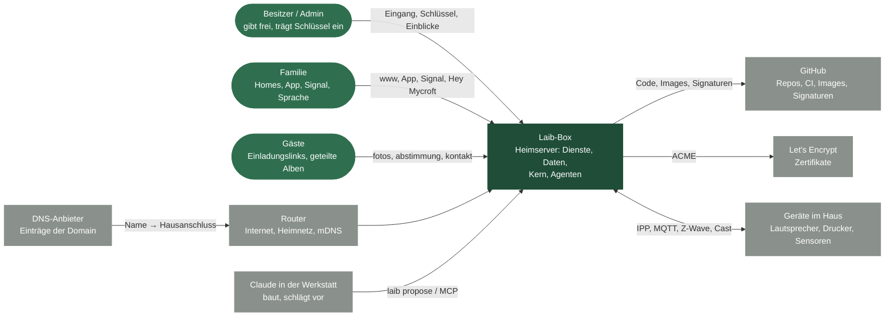
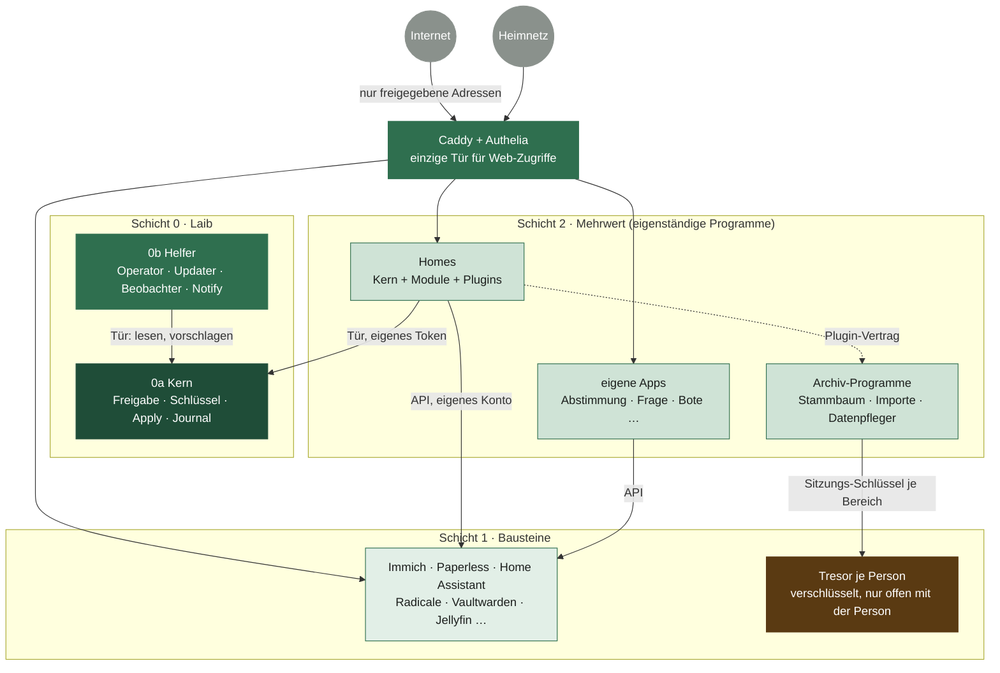

# Laib

**Laib** is the control plane for one home box, built for agents first and
humans second. The name carries the idea: the *Laib* is the daily loaf everyone
in the house takes a slice of; the *Leib* is the body of the house that agents
move as hands.

It replaces [ServiceBay](https://github.com/mdopp/servicebay) for this one box.
Nobody else runs it, so there is exactly one migration and no compatibility
layer (ADR 0010).

## What it is

- **A Git repo on the box is the only truth.** One folder per service, a
  `policy.yml`, a `box.yml`, an `age`-encrypted secrets file. Every change is a
  commit with an author, a reason and a diff. `git log` is the audit log.
- **One verb.** `laib plan` renders the state and shows the diff against the
  box; `laib apply` snapshots, writes, reloads, restarts and **verifies**. An
  apply whose verify is red is not a success.
- **systemd runs the containers**, not Laib. Laib renders Podman Quadlet files
  and reloads systemd. Restart policy and timers are systemd's; image updates
  are laib's own nightly run, verified, with the previous image back on red (#528).
- **The agent is the operator; Laib is its hands, memory and safety net.**
  Laib has no LLM code. The Operator, the box's admin agent, watches, looks
  inside containers, corrects and reports; the Bote talks with the family;
  the coding agents in the Werkstatt (pi,
  Claude Code) build what is missing. All speak the same CLI, exposed as
  MCP. Every action is journaled and reversible: snapshot before, verify
  after, rollback on red, a budget against loops. Only the irreversible
  waits for a human (ADR 0013).
- **Three human surfaces, one conversation.** The Bote is where you talk
  (Signal, Homes's Sprechen field), Homes is where the family looks and
  switches. The Werkstatt (`dev.<domain>`) is where things get built. The
  box page (`laib.<domain>`) has the Status, the Inbox, where approvals
  happen, and the Journal.

## Architecture

<!-- c4:begin -->
<!-- generated by scripts/c4.sh from docs/c4.yml, docs/sicherheit.yml and templates/; edit those, not this part -->

Three layers by purpose (ADR 0035), dependencies pointing down only. **Layer 0 · Laib** keeps the box alive, safe and reachable: ring **0a** is the trust kernel on the host (approval, keys, rights, apply, journal), ring **0b** Laib's helpers in containers with their own tokens and no age key, and the foundation services. **Layer 1 · building blocks** are standard programs that hold data or give a capability. **Layer 2 · value** is what gives the family something, built on the blocks: Homes, the archive and own apps, each a program of its own that reaches the box only through interfaces. The full map with the kernel's inside and the household's data is [`docs/C4.md`](docs/C4.md); the security concept is [`docs/SICHERHEIT.md`](docs/SICHERHEIT.md).

### Context



### Services and who needs whom

Each template in its layer; solid arrows are `after:`, dashed `uses:` and `instances:`, double the door to Laib.

```mermaid
flowchart TB
  classDef kern fill:#1f4d38,stroke:#1f4d38,color:#fff
  classDef helfer fill:#2f6f4f,stroke:#2f6f4f,color:#fff
  classDef s0 fill:#3d6b57,stroke:#3d6b57,color:#fff
  classDef s1 fill:#e2efe7,stroke:#2f6f4f,color:#1c1f1d
  classDef s2 fill:#cfe3d6,stroke:#2f6f4f,color:#1c1f1d
  classDef plan fill:#fff,stroke:#8a918c,color:#5d6a63,stroke-dasharray:4 3
  subgraph l0["Schicht 0 · Laib"]
    subgraph r0a["Ring 0a · Kern, auf dem Host"]
      laib["laib<br/>Freigabe · Schlüssel · Apply · Journal · Tür"]:::kern
      p_disk["laib-disk<br/>Platten, RAID, Auslastung"]:::kern
    end
    subgraph r0b["Ring 0b · Laibs Helfer, Container"]
      p_haushalt["Haushalt<br/>die Haushalts-Verben hinter der Tür"]:::helfer
      p_lease["Lease<br/>wer die GPU hält, Policy-Proxy des Modells"]:::helfer
      p_notify["Notify<br/>Nachrichten an den Besitzer"]:::helfer
      p_operator["Operator<br/>lokales Modell als Hand ops: Vorfälle, Morgenbericht"]:::helfer
      p_updater["Updater<br/>fragt Register und Änderungsnotizen, ohne Schlüssel und Token; der Kern prüft selbst"]:::helfer
    end
    t_adguard["AdGuard<br/>Namen im Heimnetz, Werbefilter"]:::s0
    t_auth["Anmeldung<br/>Konten und zweiter Faktor"]:::s0
    t_caddy["Webadressen<br/>Adressen und Zertifikate der Box"]:::s0
    t_werkstatt["Werkstatt<br/>Arbeitsplatz der Agenten"]:::s0
    t_whoami["Testseite<br/>Zeigt, dass die Box antwortet"]:::s0
  end
  subgraph l1["Schicht 1 · Bausteine"]
    t_audiobookshelf["Audiobookshelf<br/>Hörbücher, Hörspiele, Podcasts"]:::s1
    t_beets["Musik ordnen<br/>Erkennt und sortiert neue Musik"]:::s1
    t_druck["Drucken<br/>Jeder Drucker für jedes Gerät, ohne App"]:::s1
    t_esphome["ESPHome<br/>Firmware für Sprachgeräte und Sensoren"]:::s1
    t_file_share["Netzlaufwerk<br/>Gemeinsame Ordner im Heimnetz"]:::s1
    t_home_assistant["Home Assistant<br/>Licht, Geräte, Sprachsteuerung"]:::s1
    t_immich_public_proxy["Geteilte Fotos<br/>Geteilte Alben für Gäste"]:::s1
    t_immich["Immich<br/>Fotos und Videos"]:::s1
    t_llama["Sprachmodell<br/>Die KI der Box"]:::s1
    t_media["Jellyfin<br/>Filme, Serien, Musik"]:::s1
    t_mosquitto["Gerätenachrichten<br/>MQTT für Sensoren und Home Assistant"]:::s1
    t_music_assistant["Music Assistant<br/>Musik auf den Lautsprechern"]:::s1
    t_paperless["Paperless<br/>Dokumente, durchsuchbar"]:::s1
    t_radicale["Kalender<br/>Termine und Kontakte der Familie"]:::s1
    t_reitti["Zeitleiste<br/>Wo du warst, nur für dich"]:::s1
    t_stimme["Stimme<br/>Hören, Sprechen, Weckwort"]:::s1
    t_usage_metrics["Nutzungszähler<br/>Wie oft was genutzt wird, anonym"]:::s1
    t_vaultwarden["Vaultwarden<br/>Passwörter der Familie"]:::s1
  end
  subgraph l2["Schicht 2 · Mehrwert"]
    t_archiv["Archiv<br/>Deine Nachrichten, im Tresor nur für dich"]:::s2
    t_bote["Bote<br/>Der Assistent in Signal und Co."]:::s2
    t_frage["Fragen<br/>Websuche mit Zusammenfassung"]:::s2
    t_homes["Homes<br/>Seiten und App der Familie"]:::s2
    t_kalender["Kalender-Abos<br/>Kalender von außen, nach Radicale"]:::s2
    t_scan["Scannen<br/>Papierstapel nach Paperless, Verträge lesen"]:::s2
  end
  p_haushalt ==>|Tür| laib
  p_lease ==>|Tür| laib
  p_notify ==>|Tür| laib
  p_operator ==>|Tür| laib
  p_updater ==>|Tür| laib
  laib --> p_disk
  t_archiv -.-> t_radicale
  t_archiv -.-> t_immich
  t_audiobookshelf --> t_auth
  t_audiobookshelf --> t_file_share
  t_beets --> t_file_share
  t_bote ==>|Tür| laib
  t_bote -.-> t_home_assistant
  t_file_share --> t_auth
  t_frage -.-> t_home_assistant
  t_frage -.-> t_stimme
  t_home_assistant --> t_auth
  t_home_assistant --> t_mosquitto
  t_homes ==>|Tür| laib
  t_homes --> t_auth
  t_homes -.-> t_home_assistant
  t_homes -.-> t_reitti
  t_homes -.-> t_radicale
  t_homes -.-> t_paperless
  t_homes -.-> t_audiobookshelf
  t_homes -.-> t_media
  t_homes -.-> t_bote
  t_homes -.-> t_file_share
  t_homes -.-> t_usage_metrics
  t_homes -.-> t_immich
  t_homes -.-> t_archiv
  t_immich_public_proxy --> t_immich
  t_immich --> t_auth
  t_immich --> t_file_share
  t_kalender --> t_radicale
  t_media --> t_auth
  t_media --> t_file_share
  t_music_assistant -.-> t_home_assistant
  t_paperless --> t_auth
  t_paperless --> t_file_share
  t_radicale --> t_auth
  t_reitti --> t_auth
  t_reitti -.-> t_immich
  t_scan --> t_paperless
  t_scan --> t_file_share
  t_stimme -.-> t_home_assistant
  t_vaultwarden --> t_auth
  t_werkstatt ==>|Tür| laib
```



### Security in short

- Dependencies point down only; a higher layer never gets more rights than the one below grants it.
- Only a human changes what cannot be undone; agents and programs propose, nobody approves their own proposal.
- Every program has its own identity with exactly its rights; no shared admin logins.
- Personal data belong to the person; the archive is unreadable without them, for Laib too.
- Home network only by default; anything reachable from outside is a deliberate decision with its own login.
- What runs is verified; images pinned by digest, own images and Laib's updates signed.
- Everything leaves a trace; Laib's journal for the box, the vault's log for personal data.



Routes, ports, hands, secrets, the host-network exceptions and what still ties layer 2 to the OS: [`docs/SICHERHEIT.md`](docs/SICHERHEIT.md), generated from the code.
<!-- c4:end -->

<!-- architektur:begin -->
<!-- generated by scripts/architektur.sh from scripts/loc.sh, skills/, templates/ and docs/c4.yml; edit the script, not this part -->

The numbers behind the map above, layer by layer (ADR 0035). Lines are production lines as `scripts/loc.sh` counts them, against each program's cap; the layer of each template is `docs/c4.yml`'s. This part changes with every line of code, so a daily run brings it up to date; the diagrams above change only with the structure and are held by every PR's CI.

**The one rule that holds it together:** a hand calls a verb; what lies above the hand's ceiling becomes a proposal in the Inbox; the human class (new services, keys, programs, removal) is approved only by a human, the low-risk rest by the box itself; then Laib applies, verifies and writes the journal.

```
hand → verb → proposal → human approval (human class) → apply → journal
```

[`internal/policy`](internal/policy/) decides who may, [`internal/inbox`](internal/inbox/) judges and approves, [`internal/apply`](internal/apply/) applies and verifies, [`internal/journal`](internal/journal/) remembers.

### Layer 0 · Laib

Keeps the box alive, safe and reachable. Ring 0a is the trust kernel, ring 0b Laib's helpers; with them the foundation services below.

#### Ring 0a · the trust kernel

The part the house trusts: it must work when everything else is broken. **22,646 / 22,650, at 95 % or more** lines (`cmd/`, `internal/`).

| Part | What it does | Code | Lines |
|---|---|---|---:|
| State | box.yml, every service's values and the age secrets, a git repo with history | [`state`](internal/state/), [`secrets`](internal/secrets/), [`boxfs`](internal/boxfs/), [`staterepo.go`](cmd/laib/staterepo.go), [`secret.go`](cmd/laib/secret.go) | 2,625 |
| Render, apply, converge | template and values to Quadlet, Caddy, Authelia, AdGuard and nftables files; snapshot, write, restart, verify; keep the box on its state | [`render`](internal/render/), [`plan`](internal/plan/), [`apply`](internal/apply/), [`sysd`](internal/sysd/), [`plan.go`](cmd/laib/plan.go) | 4,094 |
| Inbox, proposal, review | proposals, the judge every proposal passes, approval by content; the owner's to-do list | [`inbox`](internal/inbox/), [`proposal`](internal/proposal/), [`review`](internal/review/), [`aufgaben`](internal/aufgaben/) | 5,475 |
| Policy and hands | which hand may call which verb up to which tier; the hands' verbs on one service; the Operator's skills | [`policy`](internal/policy/), [`token`](internal/token/), [`envelope`](internal/envelope/), [`skill`](internal/skill/), [`token.go`](cmd/laib/token.go) | 1,459 |
| Journal | append-only JSONL, everything that happened | [`journal`](internal/journal/), [`journal.go`](cmd/laib/journal.go) | 430 |
| Diag and repair | what is red, and the card that fixes it | [`diag`](internal/diag/) | 1,835 |
| Backup | the nightly restic backup, restore, the recovery sheet | [`backup`](internal/backup/) | 885 |
| Self-update | Laib itself, the services' images and templates, with the previous one back on red | [`self.go`](cmd/laib/self.go), [`updates.go`](cmd/laib/updates.go), [`registry`](internal/registry/) | 1,243 |
| Admin pages | `laib.<domain>`: Status, Inbox, Keys, Journal | [`pages`](internal/pages/) | 1,895 |
| MCP and verb door | how everyone talks to Laib: MCP, the verb table, the door to the household verbs | [`mcp`](internal/mcp/), [`cli`](internal/cli/), [`door.go`](cmd/laib/door.go) | 1,219 |
| The verbs | the one binary, CLI and daemon (`laib serve`): the verb table and the verbs no part above holds | [`cmd/laib`](cmd/laib/) | 1,486 |

#### Ring 0b and the programs beside the kernel

In this repo, each with its own cap in `scripts/loc.sh`. They talk to Laib only through its verbs, never by import. Ring, as `docs/c4.yml` places them: **helfer** ring 0b, a container with its own token, no age key; **host** beside `laib` on the host; **vorlage** part of a layer-2 service; **blatt** a shared leaf; **laptop** not on the box; **werkzeug** a tool of the repo, run in CI.

| Program | Ring | What it is | Lines / cap |
|---|---|---|---:|
| [`atomicfile/`](atomicfile/) | blatt | The durable write (temp file, fsync, rename), shared by the kernel, laib-haushalt and laib-lease | 91 / 115 |
| [`automat/`](automat/) | vorlage | Home Assistant automations as the Bote's MCP tool | 443 / 660 |
| `c4` | werkzeug | The generator of docs/C4.md, docs/SICHERHEIT.md and README's c4 section, their --check and the judgment gate (c4: docs/C4.md, docs/SICHERHEIT.md und README.md sind aktuell) | 1,707 / 2,100 |
| [`directory/`](directory/) | vorlage | The Bote's directory: its tools, levels and help, in the assistant's name (ADR 0030) | 421 / 530 |
| [`disk/`](disk/) | host | laib-disk: the data RAID, SMART and temperatures for diag, the box's load for laib auslastung | 886 / 1,110 |
| [`frage/`](frage/) | vorlage | „was ist …“: web search with a summary, OpenAI-compatible and MCP | 508 / 540 |
| [`haushalt/`](haushalt/) | helfer | laib-haushalt behind the kernel's verb door: scan, devices, tell, zuhause, person signal, wish (ADR 0026) | **1,318 / 1,320, at 95 % or more** |
| [`lease/`](lease/) | helfer | laib-lease: the model role's policy proxy and the GPU lease (ADR 0011) | 1,238 / 1,430 |
| [`mcpserver/`](mcpserver/) | blatt | The smallest MCP server, shared by the Bote's tools (frage, automat, directory) | 111 / 220 |
| [`notify/`](notify/) | helfer | laib-notify: the outside watchdog ping and messages to the owner, the chat first, else mail | **658 / 660, at 95 % or more** |
| [`operator/`](operator/) | helfer | The Operator, the admin agent: incidents, the morning report, the review (ADR 0013, 0027) | **3,299 / 3,300, at 95 % or more** |
| [`stick/`](stick/) | laptop | laib-stick on the laptop: builds the install stick for a new box | 1,468 / 1,980 |

#### The Operator's skills

10 / 55 skills in [`skills/`](skills/), each a folder with its `skill.yml` and, where it helps, one `run.py` for the steps that must always happen; the Operator runs them, [`internal/skill`](internal/skill/) checks them. Description, trigger, tools and `modell` are each `skill.yml`'s; the script's lines stand against 220. What they share: [`skills/lib/`](skills/lib/) (99 lines) and the scripts' door [`laibskill.py`](skills/laibskill.py) (198); how they play together, what each produces and who reads it: [`docs/SKILLS.md`](docs/SKILLS.md).

`modell`: **frei**, the model works in a loop with the granted tools; **urteil**, the script prepares and the model judges once; **kurz**, the script alone, with short asks of the model that never wait for it (ADR 0034); **nein**, the script alone, no model.

| Skill | Description | Runs | Modell | Tools | run.py |
|---|---|---|---|---|---:|
| [`aktualisierung`](skills/aktualisierung/) | Einmal pro Woche — neuere Patch-Versionen der festgelegten Images als Vorschläge, mit Grund. | weekly, Saturday 10:00 | urteil | `updates`, `propose`, `note`, `inbox`, `diag` | 82 / 220 |
| [`durchgang`](skills/durchgang/) | Wenn ein Durchgang rot endet — die Ursache lesen und auf die Karten schreiben, Unbeteiligtes einzeln neu vorschlagen, dem Besitzer sagen, was nur er tun kann. | when something turns red | urteil | `journal`, `inbox`, `logs`, `propose`, `aufgabe`, `note` | 191 / 220 |
| [`durchsicht`](skills/durchsicht/) | Jeden Morgen die Fehlerzeilen der Dienste nach Muster — wiederkehrende echte Fehler als Notiz oder Vorschlag, Rauschen nicht. | daily at 06:30 | urteil | `status`, `logs`, `state`, `planned`, `wish`, `note` | **220 / 220, at 95 % or more** |
| [`lehre`](skills/lehre/) | Einmal am Tag — aus einem gelösten Vorfall eine Lehre vorschlagen, die der Admin freigibt. | daily at the report hour (`OPERATOR_REPORT_AT`, 07:00 by default) | urteil | `propose`, `note` | 80 / 220 |
| [`morgenbericht`](skills/morgenbericht/) | Jeden Morgen ein Bericht — was nachts passiert ist und was ansteht, Rot zuerst. | daily at the report hour (`OPERATOR_REPORT_AT`, 07:00 by default) | frei | `status`, `diag`, `journal`, `note` | 182 / 220 |
| [`nutzung`](skills/nutzung/) | Einmal pro Woche — was die Familie nutzt und was ihr fehlt; Vorschläge, die der Admin freigibt. | weekly, Monday 08:00 | urteil | `wish`, `note` | 61 / 220 |
| [`routineblick`](skills/routineblick/) | Alle zehn Minuten ein Blick auf die Box — eine Zeile, wenn sich etwas geändert hat. | every tick (`OPERATOR_TICK`, 10 min by default) | frei | `status`, `diag`, `repair`, `aufgabe`, `note` | — |
| [`sicherung`](skills/sicherung/) | Einmal pro Woche — die Sicherung prüfen und probeweise wiederherstellen; was nicht stimmt, steht im Morgenbericht. | weekly, Sunday 05:00 | nein | `backup`, `journal`, `note` | 62 / 220 |
| [`versionen`](skills/versionen/) | Jede Nacht — neue Stände aller Images als ein Vorschlag, mit kurzer Zusammenfassung, was sich geändert hat. | daily at 05:30 | kurz | `updates`, `propose`, `note`, `inbox` | 108 / 220 |
| [`vorfall`](skills/vorfall/) | Wenn etwas rot wird — nachsehen, Ursache finden, rückgängig machbar reparieren oder eskalieren. | when something turns red | frei | `diag`, `logs`, `inspect`, `restart`, `propose`, `repair`, `escalate`, `note`; with a capable model also `look`, `read`, `journal`, `plan`, `apply`, `planned` | 102 / 220 |

#### Foundation services

Templates of layer 0: the door, the logins, the names, the Werkstatt.

| Service | Beschreibung | Runs |
|---|---|---|
| [AdGuard](templates/adguard/) `adguard` | Namen im Heimnetz, Werbefilter | [adguardhome](https://hub.docker.com/r/adguard/adguardhome) |
| [Anmeldung](templates/auth/) `auth` | Konten und zweiter Faktor | [authelia](https://hub.docker.com/r/authelia/authelia), [lldap](https://hub.docker.com/r/lldap/lldap), [valkey](https://hub.docker.com/r/valkey/valkey) |
| [Webadressen](templates/caddy/) `caddy` | Adressen und Zertifikate der Box | [laib-caddy](caddy/) |
| [Werkstatt](templates/werkstatt/) `werkstatt` | Arbeitsplatz der Agenten | [laib-werkstatt](werkstatt/) |
| [Testseite](templates/whoami/) `whoami` | Zeigt, dass die Box antwortet | [whoami](https://hub.docker.com/r/traefik/whoami) |

### Layer 1 · Building blocks

Standard programs that hold data or give a capability, no household logic of their own. Name and description are the household's, from each `laib.yml`; the software is each `values.example.yml`'s images, without the small Python helpers.

| Service | Beschreibung | Runs |
|---|---|---|
| [Audiobookshelf](templates/audiobookshelf/) `audiobookshelf` | Hörbücher, Hörspiele, Podcasts | [audiobookshelf](https://github.com/advplyr/audiobookshelf) |
| [Musik ordnen](templates/beets/) `beets` | Erkennt und sortiert neue Musik | [beets](https://hub.docker.com/r/linuxserver/beets) |
| [Drucken](templates/druck/) `druck` | Jeder Drucker für jedes Gerät, ohne App | [laib-druck](druck/) |
| [ESPHome](templates/esphome/) `esphome` | Firmware für Sprachgeräte und Sensoren | [esphome](https://github.com/esphome/esphome) |
| [Netzlaufwerk](templates/file-share/) `file-share` | Gemeinsame Ordner im Heimnetz | [syncthing](https://hub.docker.com/r/syncthing/syncthing), [samba](https://hub.docker.com/r/servercontainers/samba), [filebrowser](https://hub.docker.com/r/filebrowser/filebrowser) |
| [Home Assistant](templates/home-assistant/) `home-assistant` | Licht, Geräte, Sprachsteuerung | [home-assistant](https://github.com/home-assistant/home-assistant), [zwave-js-ui](https://github.com/zwave-js/zwave-js-ui), [python-matter-server](https://github.com/home-assistant-libs/python-matter-server) |
| [Geteilte Fotos](templates/immich-public-proxy/) `immich-public-proxy` | Geteilte Alben für Gäste | [immich-public-proxy](https://github.com/alangrainger/immich-public-proxy) |
| [Immich](templates/immich/) `immich` | Fotos und Videos | [immich-server](https://github.com/immich-app/immich), [immich-machine-learning](https://github.com/immich-app/immich), [postgres](https://github.com/immich-app/immich), [redis](https://hub.docker.com/_/redis) |
| [Sprachmodell](templates/llama/) `llama` | Die KI der Box | [llama.cpp](https://github.com/ggml-org/llama.cpp) |
| [Jellyfin](templates/media/) `media` | Filme, Serien, Musik | [jellyfin](https://hub.docker.com/r/jellyfin/jellyfin) |
| [Gerätenachrichten](templates/mosquitto/) `mosquitto` | MQTT für Sensoren und Home Assistant | [eclipse-mosquitto](https://hub.docker.com/_/eclipse-mosquitto) |
| [Music Assistant](templates/music-assistant/) `music-assistant` | Musik auf den Lautsprechern | [music-assistant](https://github.com/music-assistant/server) |
| [Paperless](templates/paperless/) `paperless` | Dokumente, durchsuchbar | [paperless-ngx](https://github.com/paperless-ngx/paperless-ngx), [postgres](https://hub.docker.com/_/postgres), [redis](https://hub.docker.com/_/redis) |
| [Kalender](templates/radicale/) `radicale` | Termine und Kontakte der Familie | [docker-radicale](https://hub.docker.com/r/tomsquest/docker-radicale) |
| [Zeitleiste](templates/reitti/) `reitti` | Wo du warst, nur für dich | [reitti](https://hub.docker.com/r/dedicatedcode/reitti), [reitti-tile-cache](https://hub.docker.com/r/dedicatedcode/reitti-tile-cache), [postgis](https://hub.docker.com/r/postgis/postgis), [redis](https://hub.docker.com/_/redis) |
| [Stimme](templates/stimme/) `stimme` | Hören, Sprechen, Weckwort | [faster-whisper](https://hub.docker.com/r/linuxserver/faster-whisper), [wyoming-piper](https://hub.docker.com/r/rhasspy/wyoming-piper), [wyoming-openwakeword](https://hub.docker.com/r/rhasspy/wyoming-openwakeword) |
| [Nutzungszähler](templates/usage-metrics/) `usage-metrics` | Wie oft was genutzt wird, anonym | [usage-metrics](https://github.com/mdopp/usage-metrics) |
| [Vaultwarden](templates/vaultwarden/) `vaultwarden` | Passwörter der Familie | [vaultwarden](https://hub.docker.com/r/vaultwarden/server) |

### Layer 2 · Value

What gives the family something, built on the blocks. Homes, the archive and the documents are programs of their own, in their own repos, run as templates; they reach the box only through Laib's door and the blocks' APIs (ADR 0035; what still ties them to the OS is listed in [`docs/SICHERHEIT.md`](docs/SICHERHEIT.md)).

#### Own programs, own repos

| Program | Repo | What it is |
|---|---|---|
| Homes | [mdopp/homes](https://github.com/mdopp/homes) | the family's pages and app, the Box page; runs as the `homes` template |
| Dokumente | [mdopp/dokumente](https://github.com/mdopp/dokumente) | scanner, splitting stacks, separator sheets, reading invoices and contracts |
| Archiv | [mdopp/archiv](https://github.com/mdopp/archiv) | each person's Signal, SMS, calls and mail in msgvault, locked in a vault only they open; imports while it is closed through an age-encrypted Briefkasten (ADR 0029); runs as the `archiv` template, once per person |

#### Services of layer 2

| Service | Beschreibung | Runs |
|---|---|---|
| [Archiv](templates/archiv/) `archiv` | Deine Nachrichten, im Tresor nur für dich | [archiv](https://github.com/mdopp/archiv) |
| [Bote](templates/bote/) `bote` | Der Assistent in Signal und Co. | [hermes-agent](https://hub.docker.com/r/nousresearch/hermes-agent), [signal-cli-rest-api](https://hub.docker.com/r/bbernhard/signal-cli-rest-api), [laib-automat](automat/), [laib-directory](directory/) |
| [Fragen](templates/frage/) `frage` | Websuche mit Zusammenfassung | [laib-frage](frage/), [searxng](https://hub.docker.com/r/searxng/searxng) |
| [Homes](templates/homes/) `homes` | Seiten und App der Familie | [homes](https://github.com/mdopp/homes), [laib-qmd](qmd/) |
| [Kalender-Abos](templates/kalender/) `kalender` | Kalender von außen, nach Radicale | own script (Python) |
| [Scannen](templates/scan/) `scan` | Papierstapel nach Paperless, Verträge lesen | [dokumente](https://github.com/mdopp/dokumente) |

<!-- architektur:end -->

## Layout

```
cmd/laib/            the one binary: CLI + daemon (`laib serve`), diag probes
internal/state       load + validate the state repo
internal/render      pure renderers: quadlet, caddy, authelia, adguard, nftables
internal/plan        state → files → diff against the box
internal/apply       snapshot, write, reload, restart, verify, the one lock
internal/journal     append-only JSONL, one file per day
internal/policy      hands, tiers, who needs approval
internal/proposal    proposals, cards, approval by content
internal/secrets     age-encrypted secrets.age
internal/token       hand tokens
internal/skill       the Operator's skills: registry, vocabulary, what the ceiling grants (ADR 0023)
internal/boxfs       the box's paths
internal/sysd        the systemctl seam
operator/            the Operator, the admin agent (ADR 0013), a container laib renders (ADR 0027): its own program and line budget (ADR 0023)
frage/               "was ist …": SearXNG + summary, OpenAI-compatible and MCP; its own program and budget (#309)
automat/             Home Assistant automations as an MCP tool in the bote pod; its own program and budget
directory/           the Bote's directory: tools, levels, help (ADR 0030); its own program and budget
mcpserver/           the smallest MCP server, shared by the Bote's tools (frage, automat, directory)
atomicfile/          the durable write (#148), a leaf the kernel and the programs share; imports nothing of laib
stick/               the laptop tool laib-stick (Butane, ISO, Ignition, write): its own program and line budget (#309)
disk/                laib-disk beside laib: the data RAID (`laib disk`), SMART and thermal for diag, the box's load for `laib auslastung` (#1047); its own program and budget (#443)
haushalt/            laib-haushalt behind the kernel's verb door, a container laib renders (ADR 0027): scan, net geraete, tell, zuhause, person signal and wish, the household verbs (ADR 0026); its own program and budget
lease/               laib-lease, the model role's policy proxy and GPU lease (ADR 0011), the llama template's container (ADR 0027): its own program and budget (#677)
notify/              laib-notify, a container on a rendered timer (ADR 0027): the outside watchdog ping and the owner's mail, over MCP as the notify hand; its own program and budget (#443)
skills/              the Operator's built-in skills, a folder each: skill.yml, embedded in laib like the templates, and run.py, run in the Operator's image (ADR 0023, #839)
templates/           built-in templates (Quadlet files + laib.yml + hooks)
usb/                 the box's Butane and the live-install scripts laib-stick embeds
werkstatt/           the dev image: repos, pi, Claude Code, autoloop
druck/               the print server's image: CUPS, cups-filters, avahi and the bundled printer drivers (templates/druck)
qmd/                 the memory library's image: qmd as released, CPU only (#195), served by the Vermittler (#198)
scripts/             install-box.sh, e2e.sh, loc.sh, ratchet.py, drift.sh, architektur.sh, c4.sh (scripts/c4: the overview pages and their gate)
docs/                KONZEPT, ZIELBILD, DESIGN, INTERFACE, STATE, TESTING, INSTALL, BACKUP, adr/
testdata/golden      renderer golden files
```

## Stand

Laib v2.34.0 <!-- x-release-please-version -->; the Kraftwerk runs Laib since
migration day (2026-10-19). What exists and how far CI proves it (what runs
on the box now: `laib status`, and `docs/ZIELBILD.md`):

| Piece | Where | Proof |
|---|---|---|
| Kernel: state repo, plan/apply, converge, operator verbs, MCP, pages | `cmd/laib`, `internal/` | unit + golden tests, e2e with shims, real Quadlet on a runner |
| The stick: `laib-stick`, first boot, data disk (RAID1, one member) | `stick/`, `usb/` | CI `vm-install`: KVM guest installs CoreOS, reboots, `laib` ready, mirror joins, reinstall keeps data |
| First services: Caddy (own CA on a trial box), backup + restore | `templates/caddy`, `cmd/laib backup.go` | the same VM run: HTTPS 200, restic round trip |
| Operator (admin agent), lease, Frage | `operator/`, `lease/`, `frage/` | e2e with a scripted model; against the box's model: the Operator runs and its last morning report is green <!-- box: laib status ~ "operator": "läuft" ~ "morgenbericht": \{[^}]*"outcome": "green" --> *(box 2026-11-12: yes)* |
| Bote (Hermes on Signal, Matrix and/or Telegram) with the `ha` and `automat` tools; approvals only in the Inbox (#778) | `templates/bote`, `automat/` | config rendered and checked against Hermes' source; automat unit-tested against a fake HA |
| Homes (the surface): Box page, pairing, companion API for the widgets | `mdopp/homes`, `templates/homes` | unit tests against a fake Laib; installed on the Kraftwerk by hand after migration day (#379) |
| 29 templates for every unit the box runs today | `templates/` | lint + render; caddy, auth, adguard and radicale installed in the VM |

The NUC trial (#23, #27) was the first real run; `docs/INSTALL.md` has the
pre-flight. The Kraftwerk runs Laib since migration day (2026-10-19); what
runs there and what is open is `docs/ZIELBILD.md`.

## Read first

0. [`docs/ZIELBILD.md`](docs/ZIELBILD.md) — what we have: the Kraftwerk as it
   runs, what moved out of ServiceBay and Solaris, what is dropped, what is open.
1. [`docs/KONZEPT.md`](docs/KONZEPT.md) — the whole concept as decided:
   constructs, division of labour, interfaces by user group, models.
   [`docs/DESIGN.md`](docs/DESIGN.md) is the kernel's design underneath.
2. [`docs/INTERFACE.md`](docs/INTERFACE.md) — the CLI, the MCP surface, the
   three pages, the messages to the owner, the readiness signal.
3. [`docs/STATE.md`](docs/STATE.md) — the state repo layout and every file's
   schema.
   [`docs/SKILLS.md`](docs/SKILLS.md) is the Operator's skills together:
   who triggers what, what each leaves, who reads it.
4. [`docs/adr/`](docs/adr/) — the decisions. Read the index in
   [`docs/adr/README.md`](docs/adr/README.md) before changing anything about
   runtime, identity, proxy, templates or tests.
5. [`docs/adr/0010-one-migration-no-compat.md`](docs/adr/0010-one-migration-no-compat.md)
   — the one-shot move from ServiceBay (done 2026-10-19; its runbook and
   scripts are in git history).
6. [`docs/DEKONSTRUKTION.md`](docs/DEKONSTRUKTION.md) — history: how the
   retired Solaris and its Android app were cut into Homes, Stimme, the Bote
   and the Laib Operator.
7. [`docs/C4.md`](docs/C4.md) — the system map in four C4 levels (context,
   services in their layers, the kernel's inside, capabilities), the
   household's data and the "a service for the family" sequence; and
   [`docs/SICHERHEIT.md`](docs/SICHERHEIT.md) — the security concept:
   principles, zones, identities, routes, ports, hands, secrets, what
   happens if, open points. Both generated by `scripts/c4.sh` from the code
   and from `docs/c4.yml`, `docs/sicherheit.yml`.
8. [`docs/SERVICES.md`](docs/SERVICES.md) — what runs on the box today
   and which templates Laib still needs for it.
9. [`docs/DATA.md`](docs/DATA.md) — whose data each service keeps, who
   logs in, what the admin sees, which keys reach it, and where one
   person's data reaches others.
10. [`docs/BACKUP.md`](docs/BACKUP.md), [`docs/INSTALL.md`](docs/INSTALL.md),
   [`docs/OUTSIDE.md`](docs/OUTSIDE.md) — backup, install, and what Laib
   leaves to the router, to LLDAP and to nobody.

## Build

```
go build ./cmd/laib
go test ./...
```

Go 1.27, no CGO, one static binary. The binary is installed on Fedora CoreOS
via Ignition at `/var/opt/laib/laib` and runs as a systemd user service of the
`core` user (ADR 0002).

## Status

Founded 2026-10-08; reviewed 2026-10-11 (#31, worked through #60) and
2026-10-28 (#851). The NUC trial (#23) was the first real run; the Kraftwerk
moved from ServiceBay to Laib on 2026-10-19 (ADR 0010). What runs there is
`docs/ZIELBILD.md`; `docs/REVIEW.md` is the review brief of 2026-10-11, kept
as history.
