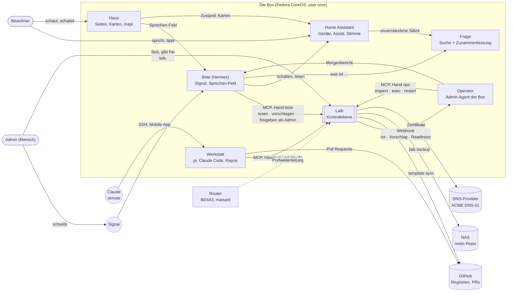
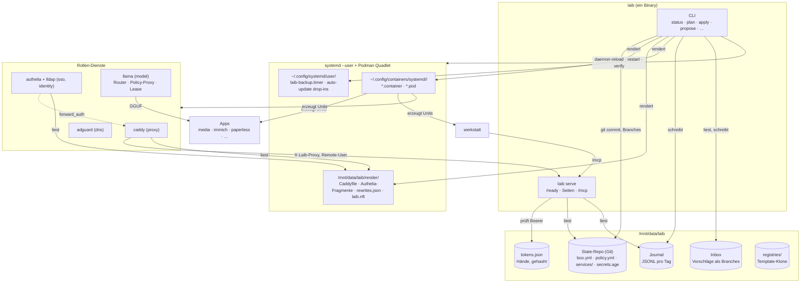
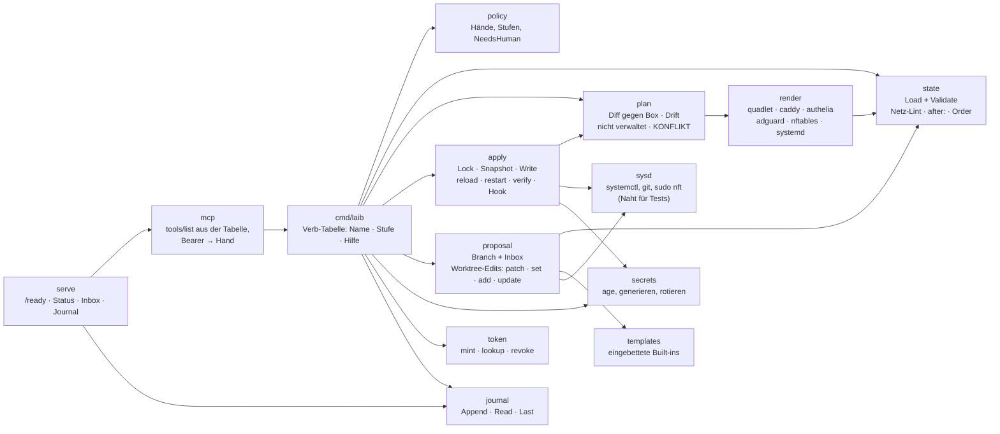
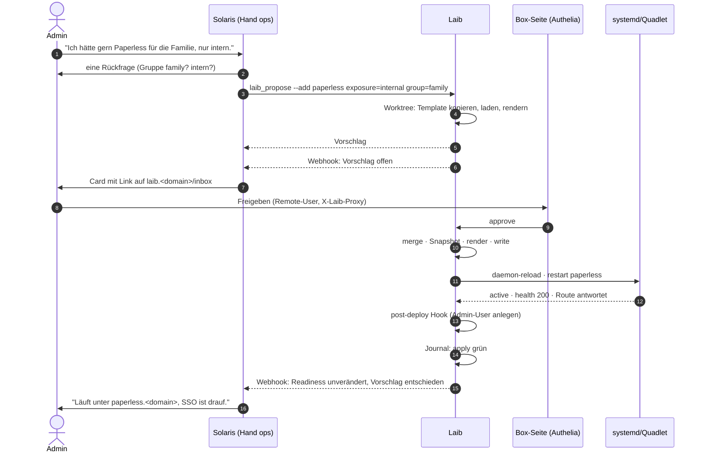

# Laib — system map (C4)

Three levels plus one sequence. Mermaid sources; a rendered copy is linked
from the README. Keep this in step with `docs/DESIGN.md` and the ADRs.

## Level 1 — Context

## Level 2 — Containers on the box

## Level 3 — Components inside the binary

## Sequence — "Paperless für die Familie, nur intern"

