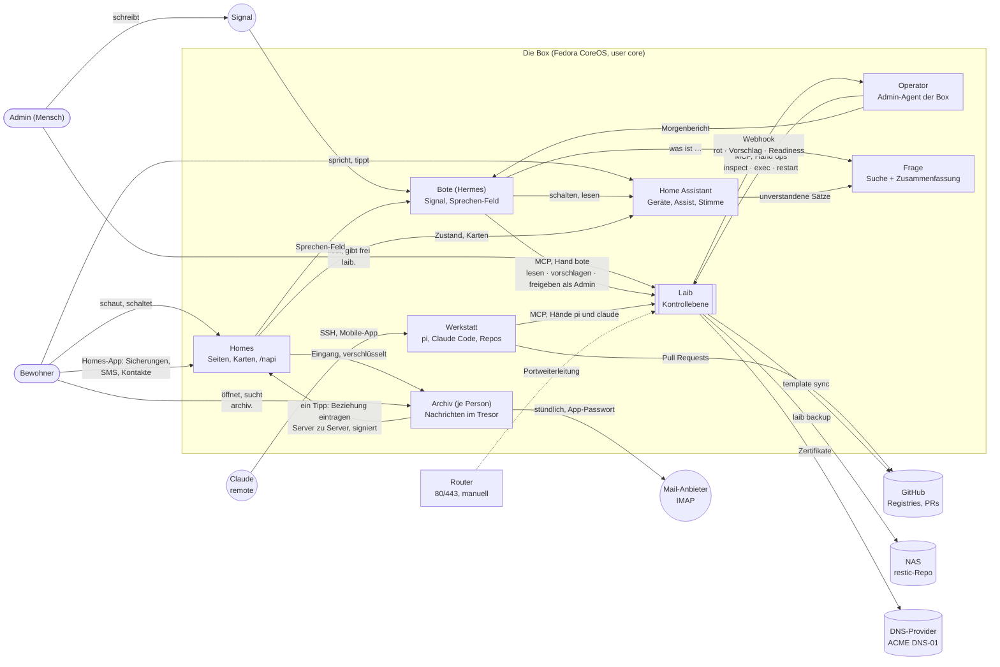
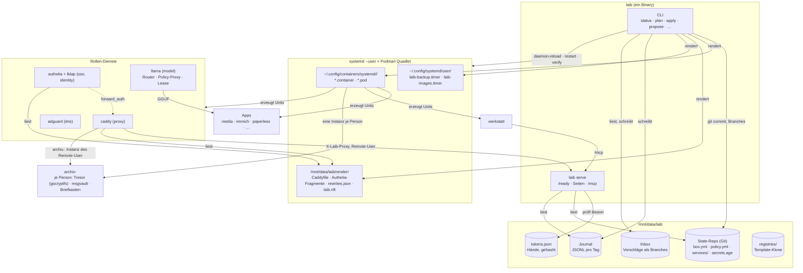
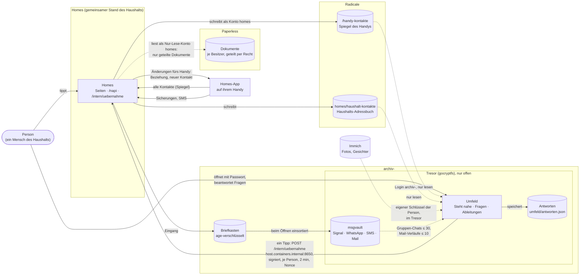
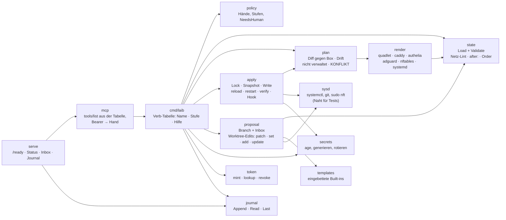
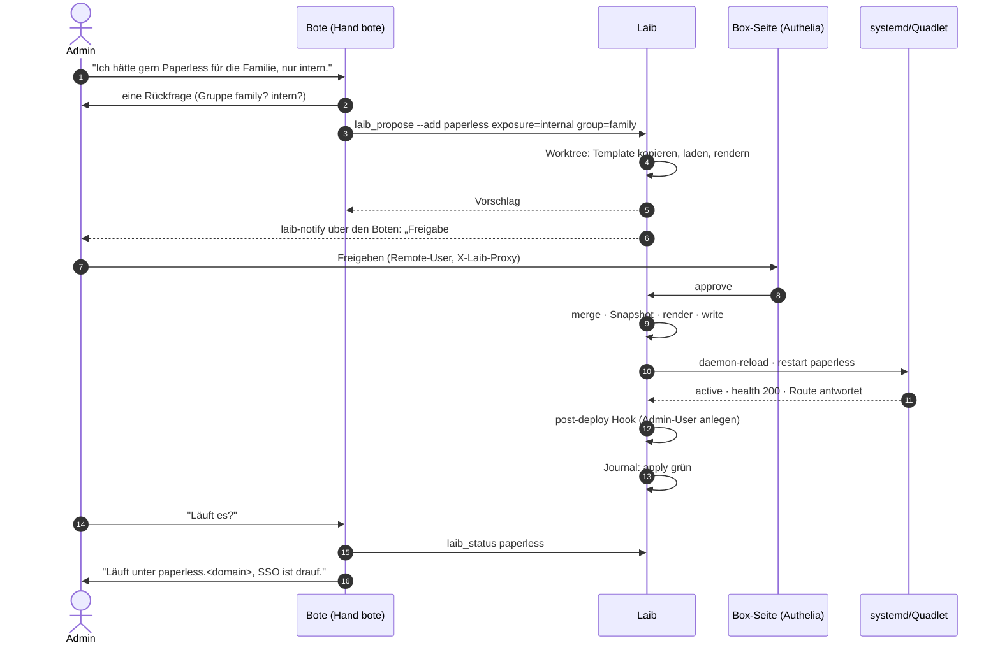

# Laib — system map (C4)

Three levels plus one sequence. Mermaid sources; a rendered copy is linked
from the README. Keep this in step with `docs/DESIGN.md` and the ADRs.

## Level 1 — Context

## Level 2 — Containers on the box

## Level 2b — Household data: whose data, who reads, who writes

The services that hold the family's data and the paths between them, as
`docs/DATA.md` states them (ownership, accounts, keys). A solid arrow
writes, a dashed one only reads. Everything inside „Tresor“ exists only
while the person's archive is open.

Rules this map carries (details in `docs/DATA.md`):
- A household card only ever names household contacts (by UID); a
  relation involving the person's own phone contact goes only to their
  phone.
- Nothing the archive computes leaves the vault except what the person
  writes with a tap; a closed vault computes nothing.
- Homes reads Paperless with its own read-only account `homes`, never with
  a person's token; it sees only what is shared with it.
- `/intern/uebernahme` is Homes' own port on the box, never reached
  through Caddy; a request carrying proxy headers is refused.

## Level 3 — Components inside the binary

## Sequence — "Paperless für die Familie, nur intern"

