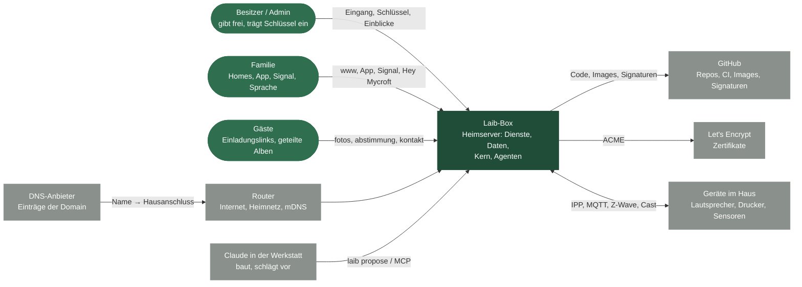
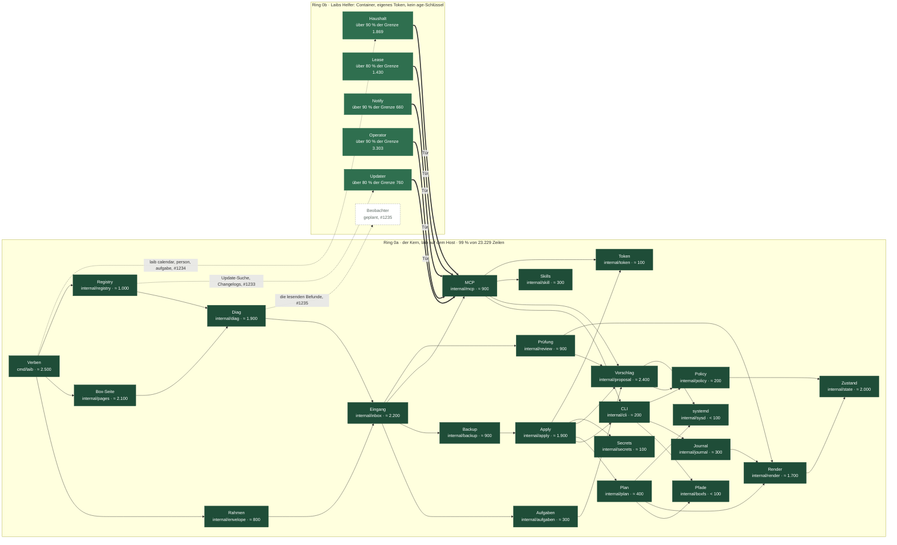
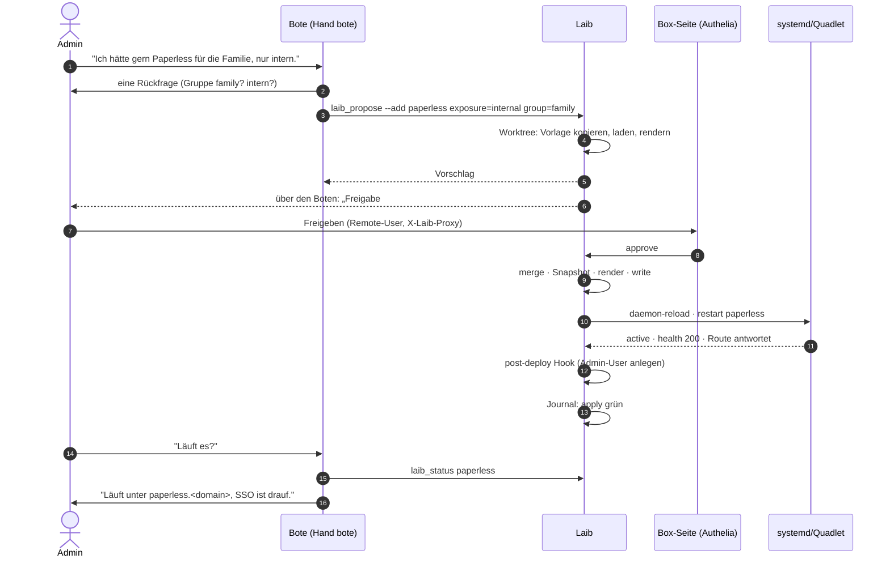

# Laib in C4

<!-- erzeugt von scripts/c4.sh aus docs/c4.yml, templates/*/laib.yml, internal/, cmd/laib und scripts/loc.sh; ändere die Quellen, nicht diese Datei -->

Was Laib kann und wie es mit den Diensten, der Familie und der Außenwelt zusammenhängt, von außen nach innen: Umfeld, Dienste der Box, Laibs Kern, Fähigkeiten. Die Schichten und Ringe sind ADR 0035: Schicht 0 ist Laib (Ring 0a der Kern, Ring 0b Laibs Helfer), Schicht 1 die Bausteine, Schicht 2 der Mehrwert; Abhängigkeiten zeigen nur nach unten.

## Ebene 1 · Umfeld: wer mit der Box spricht

Laib ändert die Box nur über Freigaben. Agenten, auch Claude, schlagen vor und gehen in private Daten nur mit einer Einblick-Karte (ADR 0032).

## Ebene 2 · Container: die Dienste der Box und wer wen braucht

Jede Vorlage in ihrer Schicht (`docs/c4.yml`), die Pfeile aus ihrer `laib.yml`: durchgezogen `after:` (startet nach), gestrichelt `uses:` und `instances:` (spricht mit), doppelt die Tür zu Laib (`needs: [mcp]`, Laibs Helfer). Abhängigkeiten zeigen nur nach unten (ADR 0035).

```mermaid
flowchart TB
  classDef kern fill:#1f4d38,stroke:#1f4d38,color:#fff
  classDef helfer fill:#2f6f4f,stroke:#2f6f4f,color:#fff
  classDef s0 fill:#3d6b57,stroke:#3d6b57,color:#fff
  classDef s1 fill:#e2efe7,stroke:#2f6f4f,color:#1c1f1d
  classDef s2 fill:#cfe3d6,stroke:#2f6f4f,color:#1c1f1d
  classDef plan fill:#fff,stroke:#8a918c,color:#5d6a63,stroke-dasharray:4 3
  subgraph l0["Schicht 0 · Laib"]
    subgraph r0a["Ring 0a · Kern, auf dem Host"]
      laib["laib<br/>Freigabe · Schlüssel · Apply · Journal · Tür"]:::kern
      p_disk["laib-disk<br/>Platten, RAID, Auslastung"]:::kern
    end
    subgraph r0b["Ring 0b · Laibs Helfer, Container"]
      p_haushalt["Haushalt<br/>die Haushalts-Verben hinter der Tür"]:::helfer
      p_lease["Lease<br/>wer die GPU hält, Policy-Proxy des Modells"]:::helfer
      p_notify["Notify<br/>Nachrichten an den Besitzer"]:::helfer
      p_operator["Operator<br/>lokales Modell als Hand ops: Vorfälle, Morgenbericht"]:::helfer
      p_updater["Updater<br/>fragt Register und Änderungsnotizen, ohne Schlüssel und Token; der Kern prüft selbst"]:::helfer
    end
    t_adguard["AdGuard<br/>Namen im Heimnetz, Werbefilter"]:::s0
    t_auth["Anmeldung<br/>Konten und zweiter Faktor"]:::s0
    t_caddy["Webadressen<br/>Adressen und Zertifikate der Box"]:::s0
    t_werkstatt["Werkstatt<br/>Arbeitsplatz der Agenten"]:::s0
    t_whoami["Testseite<br/>Zeigt, dass die Box antwortet"]:::s0
  end
  subgraph l1["Schicht 1 · Bausteine"]
    t_audiobookshelf["Audiobookshelf<br/>Hörbücher, Hörspiele, Podcasts"]:::s1
    t_beets["Musik ordnen<br/>Erkennt und sortiert neue Musik"]:::s1
    t_druck["Drucken<br/>Jeder Drucker für jedes Gerät, ohne App"]:::s1
    t_esphome["ESPHome<br/>Firmware für Sprachgeräte und Sensoren"]:::s1
    t_file_share["Netzlaufwerk<br/>Gemeinsame Ordner im Heimnetz"]:::s1
    t_home_assistant["Home Assistant<br/>Licht, Geräte, Sprachsteuerung"]:::s1
    t_immich_public_proxy["Geteilte Fotos<br/>Geteilte Alben für Gäste"]:::s1
    t_immich["Immich<br/>Fotos und Videos"]:::s1
    t_llama["Sprachmodell<br/>Die KI der Box"]:::s1
    t_media["Jellyfin<br/>Filme, Serien, Musik"]:::s1
    t_mosquitto["Gerätenachrichten<br/>MQTT für Sensoren und Home Assistant"]:::s1
    t_music_assistant["Music Assistant<br/>Musik auf den Lautsprechern"]:::s1
    t_paperless["Paperless<br/>Dokumente, durchsuchbar"]:::s1
    t_radicale["Kalender<br/>Termine und Kontakte der Familie"]:::s1
    t_reitti["Zeitleiste<br/>Wo du warst, nur für dich"]:::s1
    t_stimme["Stimme<br/>Hören, Sprechen, Weckwort"]:::s1
    t_usage_metrics["Nutzungszähler<br/>Wie oft was genutzt wird, anonym"]:::s1
    t_vaultwarden["Vaultwarden<br/>Passwörter der Familie"]:::s1
  end
  subgraph l2["Schicht 2 · Mehrwert"]
    t_archiv["Archiv<br/>Deine Nachrichten, im Tresor nur für dich"]:::s2
    t_bote["Bote<br/>Der Assistent in Signal und Co."]:::s2
    t_frage["Fragen<br/>Websuche mit Zusammenfassung"]:::s2
    t_homes["Homes<br/>Seiten und App der Familie"]:::s2
    t_kalender["Kalender-Abos<br/>Kalender von außen, nach Radicale"]:::s2
    t_scan["Scannen<br/>Papierstapel nach Paperless, Verträge lesen"]:::s2
  end
  p_haushalt ==>|Tür| laib
  p_lease ==>|Tür| laib
  p_notify ==>|Tür| laib
  p_operator ==>|Tür| laib
  p_updater ==>|Tür| laib
  laib --> p_disk
  t_archiv -.-> t_radicale
  t_archiv -.-> t_immich
  t_audiobookshelf --> t_auth
  t_audiobookshelf --> t_file_share
  t_beets --> t_file_share
  t_bote ==>|Tür| laib
  t_bote -.-> t_home_assistant
  t_file_share --> t_auth
  t_frage -.-> t_home_assistant
  t_frage -.-> t_stimme
  t_home_assistant --> t_auth
  t_home_assistant --> t_mosquitto
  t_homes ==>|Tür| laib
  t_homes --> t_auth
  t_homes -.-> t_home_assistant
  t_homes -.-> t_reitti
  t_homes -.-> t_radicale
  t_homes -.-> t_paperless
  t_homes -.-> t_audiobookshelf
  t_homes -.-> t_media
  t_homes -.-> t_bote
  t_homes -.-> t_file_share
  t_homes -.-> t_usage_metrics
  t_homes -.-> t_immich
  t_homes -.-> t_archiv
  t_immich_public_proxy --> t_immich
  t_immich --> t_auth
  t_immich --> t_file_share
  t_kalender --> t_radicale
  t_media --> t_auth
  t_media --> t_file_share
  t_music_assistant -.-> t_home_assistant
  t_paperless --> t_auth
  t_paperless --> t_file_share
  t_radicale --> t_auth
  t_reitti --> t_auth
  t_reitti -.-> t_immich
  t_scan --> t_paperless
  t_scan --> t_file_share
  t_stimme -.-> t_home_assistant
  t_vaultwarden --> t_auth
  t_werkstatt ==>|Tür| laib
```

| Dienst | Schicht | Was | startet nach | spricht mit |
|---|---|---|---|---|
| [AdGuard](../templates/adguard/) `adguard` | 0 | Namen im Heimnetz, Werbefilter | — | — |
| [Archiv](../templates/archiv/) `archiv` | 2 | Deine Nachrichten, im Tresor nur für dich | — | `immich`, `radicale` |
| [Audiobookshelf](../templates/audiobookshelf/) `audiobookshelf` | 1 | Hörbücher, Hörspiele, Podcasts | `auth`, `file-share` | — |
| [Anmeldung](../templates/auth/) `auth` | 0 | Konten und zweiter Faktor | — | — |
| [Musik ordnen](../templates/beets/) `beets` | 1 | Erkennt und sortiert neue Musik | `file-share` | — |
| [Bote](../templates/bote/) `bote` | 2 | Der Assistent in Signal und Co. | — | `home-assistant` |
| [Webadressen](../templates/caddy/) `caddy` | 0 | Adressen und Zertifikate der Box | — | — |
| [Drucken](../templates/druck/) `druck` | 1 | Jeder Drucker für jedes Gerät, ohne App | — | — |
| [ESPHome](../templates/esphome/) `esphome` | 1 | Firmware für Sprachgeräte und Sensoren | — | — |
| [Netzlaufwerk](../templates/file-share/) `file-share` | 1 | Gemeinsame Ordner im Heimnetz | `auth` | — |
| [Fragen](../templates/frage/) `frage` | 2 | Websuche mit Zusammenfassung | — | `home-assistant`, `stimme` |
| [Home Assistant](../templates/home-assistant/) `home-assistant` | 1 | Licht, Geräte, Sprachsteuerung | `auth`, `mosquitto` | — |
| [Homes](../templates/homes/) `homes` | 2 | Seiten und App der Familie | `auth` | `archiv`, `archiv`, `audiobookshelf`, `bote`, `file-share`, `home-assistant`, `immich`, `media`, `paperless`, `radicale`, `reitti`, `reitti`, `usage-metrics` |
| [Geteilte Fotos](../templates/immich-public-proxy/) `immich-public-proxy` | 1 | Geteilte Alben für Gäste | `immich` | — |
| [Immich](../templates/immich/) `immich` | 1 | Fotos und Videos | `auth`, `file-share` | — |
| [Kalender-Abos](../templates/kalender/) `kalender` | 2 | Kalender von außen, nach Radicale | `radicale` | — |
| [Sprachmodell](../templates/llama/) `llama` | 1 | Die KI der Box | — | — |
| [Jellyfin](../templates/media/) `media` | 1 | Filme, Serien, Musik | `auth`, `file-share` | — |
| [Gerätenachrichten](../templates/mosquitto/) `mosquitto` | 1 | MQTT für Sensoren und Home Assistant | — | — |
| [Music Assistant](../templates/music-assistant/) `music-assistant` | 1 | Musik auf den Lautsprechern | — | `home-assistant` |
| [Paperless](../templates/paperless/) `paperless` | 1 | Dokumente, durchsuchbar | `auth`, `file-share` | — |
| [Kalender](../templates/radicale/) `radicale` | 1 | Termine und Kontakte der Familie | `auth` | — |
| [Zeitleiste](../templates/reitti/) `reitti` | 1 | Wo du warst, nur für dich | `auth` | `immich` |
| [Scannen](../templates/scan/) `scan` | 2 | Papierstapel nach Paperless, Verträge lesen | `paperless`, `file-share` | — |
| [Stimme](../templates/stimme/) `stimme` | 1 | Hören, Sprechen, Weckwort | — | `home-assistant` |
| [Nutzungszähler](../templates/usage-metrics/) `usage-metrics` | 1 | Wie oft was genutzt wird, anonym | — | — |
| [Vaultwarden](../templates/vaultwarden/) `vaultwarden` | 1 | Passwörter der Familie | `auth` | — |
| [Werkstatt](../templates/werkstatt/) `werkstatt` | 0 | Arbeitsplatz der Agenten | — | — |
| [Testseite](../templates/whoami/) `whoami` | 0 | Zeigt, dass die Box antwortet | — | — |

## Ebene 2b · Haushaltsdaten: wessen Daten, wer liest, wer schreibt

Die Dienste mit den Daten der Familie und die Wege zwischen ihnen, wie `docs/DATA.md` sie festhält (Besitz, Konten, Schlüssel). Ein durchgezogener Pfeil schreibt, ein gestrichelter liest nur. Alles im „Tresor“ gibt es nur, solange das Archiv der Person offen ist.

```mermaid
flowchart LR
  person(["Person<br/>(ein Mensch des Haushalts)"])
  handy["Homes-App<br/>auf ihrem Handy"]
  subgraph homesbox["Homes (gemeinsamer Stand des Haushalts)"]
    homes["Homes<br/>Seiten · /napi · /intern/uebernahme"]
  end
  subgraph radicale["Radicale"]
    hb[("homes/haushalt-kontakte<br/>Haushalts-Adressbuch")]
    pb[("#lt;person#gt;/handy-kontakte<br/>Spiegel des Handys")]
  end
  subgraph paperless["Paperless"]
    pdocs[("Dokumente<br/>je Besitzer, geteilt per Recht")]
  end
  immich[("Immich<br/>Fotos, Gesichter")]
  subgraph archivbox["archiv-#lt;person#gt;"]
    brief[("Briefkasten<br/>age-verschlüsselt")]
    subgraph tresor["Tresor (gocryptfs), nur offen"]
      mv[("msgvault<br/>Signal · WhatsApp · SMS · Mail")]
      umfeld["Umfeld<br/>Steht nahe · Fragen · Ableitungen"]
      antw[("Antworten<br/>umfeld/antworten.json")]
    end
  end
  person -->|"tippt"| homes
  person -->|"öffnet mit Passwort,<br/>beantwortet Fragen"| umfeld
  handy -->|"alle Kontakte (Spiegel)"| homes
  homes -->|"schreibt als Konto homes"| pb
  homes -->|"schreibt"| hb
  homes -.->|"liest als Nur-Lese-Konto homes:<br/>nur geteilte Dokumente"| pdocs
  homes -->|"Änderungen fürs Handy:<br/>Beziehung, neuer Kontakt"| handy
  handy -->|"Sicherungen, SMS"| homes
  homes -->|"Eingang"| brief
  brief -->|"beim Öffnen einsortiert"| mv
  pb -.->|"Login archiv-#lt;person#gt;, nur lesen"| umfeld
  hb -.->|"nur lesen"| umfeld
  immich -.->|"eigener Schlüssel der Person,<br/>im Tresor"| umfeld
  mv -.->|"Gruppen-Chats ≤ 30,<br/>Mail-Verläufe ≤ 10"| umfeld
  umfeld -->|"speichert"| antw
  umfeld -->|"ein Tipp: POST /intern/uebernahme<br/>signiert, je Person, 2 min, Nonce"| homes
```

Regeln, die diese Karte trägt (Einzelheiten in `docs/DATA.md`):

- Eine Haushaltskarte nennt nur Haushaltskontakte (per UID); eine Beziehung mit dem eigenen Handy-Kontakt der Person geht nur auf ihr Handy.
- Nichts, was das Archiv berechnet, verlässt den Tresor, außer was die Person mit einem Tipp schreibt; ein geschlossener Tresor rechnet nichts.
- Homes liest Paperless mit seinem eigenen Nur-Lese-Konto `homes`, nie mit dem Token einer Person; es sieht nur, was mit ihm geteilt ist.
- `/intern/uebernahme` ist Homes' eigener Port auf der Box, nie über Caddy erreichbar; eine Anfrage mit Proxy-Kopfzeilen wird abgelehnt.

## Ebene 3 · Komponenten: Laibs Kern von innen

Die Pakete des Kerns mit ihren Importen (ohne die, die ein anderer Weg schon zeigt) und Laibs Helfer im Ring 0b; gestrichelt, was ADR 0035 aus dem Kern in den Ring 0b verlegt. Zeilen auf hundert gerundet, wie `scripts/loc.sh` zählt; genau stehen sie im README.

| Paket | Teil | Was | Zeilen | Zieht nach 0b |
|---|---|---|---|---|
| [`cmd/laib`](../cmd/laib/) | Verben | das eine Binary, CLI und Daemon, die Verb-Tabelle | ≈ 2.500 | Haushalt: laib calendar, person, aufgabe ([#1234](https://github.com/mdopp/laib/issues/1234)) |
| [`internal/apply`](../internal/apply/) | Apply | Sperre, Snapshot, Schreiben, Neustart, Prüfen, Zurück | ≈ 1.900 | — |
| [`internal/aufgaben`](../internal/aufgaben/) | Aufgaben | für Menschen, mit Weg | ≈ 300 | — |
| [`internal/backup`](../internal/backup/) | Backup | restic jede Nacht, Wiederherstellung, Probe | ≈ 900 | — |
| [`internal/boxfs`](../internal/boxfs/) | Pfade | die Pfade der Box | < 100 | — |
| [`internal/cli`](../internal/cli/) | CLI | Umgebung, Ausgabe, Ablehnung | ≈ 200 | — |
| [`internal/diag`](../internal/diag/) | Diag | Befunde, Reparatur-Vorschläge | ≈ 1.900 | Beobachter: die lesenden Befunde ([#1235](https://github.com/mdopp/laib/issues/1235)) |
| [`internal/envelope`](../internal/envelope/) | Rahmen | Eingriffsbudget je Dienst und Stunde | ≈ 800 | — |
| [`internal/inbox`](../internal/inbox/) | Eingang | Vorschläge, Freigaben, Läufe einzeln zurück | ≈ 2.200 | — |
| [`internal/journal`](../internal/journal/) | Journal | eine JSONL-Datei je Tag, nur anhängen | ≈ 300 | — |
| [`internal/mcp`](../internal/mcp/) | MCP | die Tür: Verben als Werkzeuge, je Hand ein Token | ≈ 900 | — |
| [`internal/pages`](../internal/pages/) | Box-Seite | Status, Eingang, Schlüssel, Journal | ≈ 2.100 | — |
| [`internal/plan`](../internal/plan/) | Plan | Zustand gegen Box, Abweichung | ≈ 400 | — |
| [`internal/policy`](../internal/policy/) | Policy | Hände, Stufen, wer freigibt | ≈ 200 | — |
| [`internal/proposal`](../internal/proposal/) | Vorschlag | Branch, Karte, Text für den Menschen | ≈ 2.400 | — |
| [`internal/registry`](../internal/registry/) | Registry | Vorlagen, Lint, Pins, Signaturen | ≈ 1.000 | Updater: Update-Suche, Changelogs ([#1233](https://github.com/mdopp/laib/issues/1233)) |
| [`internal/render`](../internal/render/) | Render | Quadlet, Caddy, Authelia, AdGuard, nftables | ≈ 1.700 | — |
| [`internal/review`](../internal/review/) | Prüfung | was nur ein Mensch freigibt | ≈ 900 | — |
| [`internal/secrets`](../internal/secrets/) | Secrets | age, nur beim Apply offen | ≈ 100 | — |
| [`internal/skill`](../internal/skill/) | Skills | die Skills des Operators | ≈ 300 | — |
| [`internal/state`](../internal/state/) | Zustand | box.yml, policy.yml, services/, laden und prüfen | ≈ 2.000 | — |
| [`internal/sysd`](../internal/sysd/) | systemd | systemctl, git, nft: die Naht für Tests | < 100 | — |
| [`internal/token`](../internal/token/) | Token | ausgeben, nachschlagen, widerrufen | ≈ 100 | — |

## Ebene 4 · Fähigkeiten: was Laib kann

**Ändern, nur mit Freigabe**

- Vorschlag als Karte, Freigabe durch einen Menschen
- Snapshot vor jedem Apply, rotes Ergebnis → zurück
- Karten können auf andere Karten oder Aufgaben warten
- eine rote Karte nimmt nur sich selbst zurück

**Aktuell bleiben**

- Images per Prüfsumme festgehalten, neue als Karte
- eigene Images nur mit CI-Signatur
- Laib-Updates signiert geprüft
- Vorlagen aus den Registries

**Selbst gesund bleiben**

- Converge bringt Abweichungen zurück
- Diag mit Befunden und Reparatur-Vorschlägen
- Operator: Routineblick, Vorfälle, „Durchgang rot“
- Nachricht nach 10 Minuten rot, Helfer nur gelb

**Schützen**

- Hände mit Stufen und Eingriffsbudget je Stunde
- private Dienste nur mit Einblick-Karte, Archiv versiegelt
- Secrets in age, nie im Repo
- öffentliche Adressen nur mit Freigabe
- das ganze Konzept: [`docs/SICHERHEIT.md`](SICHERHEIT.md)

**Sichern**

- restic jede Nacht, mit Wiederherstellungsprobe
- noch keine Kopie außer Haus (#1128)

**Agenten tragen**

- Werkstatt mit Claude Code und pi
- MCP aus den CLI-Verben erzeugt
- `laib context` als Einstieg
- Abläufe: Versprechen mit Tests (`docs/ABLAEUFE.md`)

## Ablauf · „Paperless für die Familie, nur intern“

