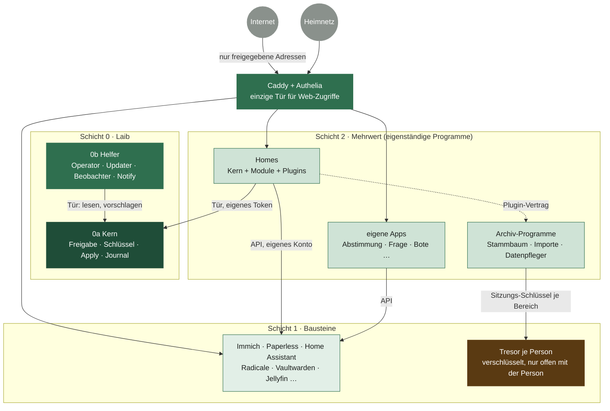

# Sicherheitskonzept der Box

<!-- erzeugt von scripts/c4.sh aus docs/sicherheit.yml, templates/, templates/hostnet.yml und internal/state; ändere die Quellen, nicht diese Datei -->

Wie die Box Zugriffe und Daten schützt, von Laib über die Bausteine bis zu Homes, dem Archiv und fremden Apps. Grundlage ist ADR 0035 (drei Schichten), dazu der Tresor und die Plugins. Jeder Punkt ist markiert, ob er schon so läuft, geplant ist oder eine bekannte Lücke ist; die Tabellen mit Adressen, Ports, Händen, Geheimnissen und Ausnahmen sind aus dem Code erzeugt.

## Sieben Grundsätze

1. **Abhängigkeiten nur nach unten.** Mehrwert-Programme brauchen Bausteine und Laib, Bausteine brauchen Laib, Laib braucht niemanden. Wer weiter oben steht, bekommt nie mehr Rechte als die Schicht darunter ihm gibt.
2. **Nur ein Mensch ändert Unumkehrbares.** Agenten und Programme schlagen vor; öffentliche Adressen, Löschen, Neustart der Box und Rechte gibt ein Mensch frei. Niemand gibt seinen eigenen Vorschlag frei.
3. **Jedes Programm hat eine eigene Identität mit genau seinen Rechten.** Hände mit Token und Stufe, Dienste mit eigenen Konten, keine gemeinsamen Admin-Zugänge.
4. **Persönliche Daten gehören der Person.** Familie, Admin und Agenten sehen sie nur, wenn die Person sie freigibt; das Archiv ist ohne die Person nicht lesbar, auch nicht für Laib.
5. **Standard: nur im Heimnetz.** Was von außen erreichbar ist, ist eine bewusste Entscheidung mit eigener Anmeldung.
6. **Was läuft, ist geprüft.** Images per Prüfsumme festgehalten, eigene nur mit Signatur, Laibs Updates signiert.
7. **Alles hinterlässt eine Spur.** Laibs Journal für die Box, das Protokoll des Tresors für persönliche Daten.

## Zonen und Grenzen

Durchgezogene Pfeile sind die einzigen erlaubten Wege. Kein Programm der Schicht 2 erreicht das Betriebssystem; der Tresor ist nur über Sitzungs-Schlüssel erreichbar.

## Wer ist wer: Identitäten

| Wer | Wie erkannt | Darf | Stand |
|---|---|---|---|
| Familienmitglied | Konto in LLDAP, Anmeldung über Authelia, zweiter Faktor von außen | Homes, die eigenen Bausteine-Konten, eigene Daten | läuft |
| Admin (Besitzer) | wie oben, Gruppe admins, Box-Seite nur im Heimnetz, zweiter Faktor | freigeben, Schlüssel eintragen, Einblicke erteilen; nicht: fremde Archive lesen | läuft |
| Gast | Einladungslink mit geheimem Wort oder geteiltes Album | genau die eine App oder das eine Album | läuft |
| Hand (Agent oder Programm) | eigenes Token mit Ablauf, Stufe in policy.yml (Tabelle „Hände und Stufen“) | bis zu ihrer Stufe: lesen, vorschlagen, im Rahmen anwenden; nie sich selbst freigeben | läuft |
| Dienst (Baustein) | eigenes Dienstkonto beim anderen Dienst, Schlüssel nur in secrets.age (Tabelle „Geheimnisse“) | nur was er fachlich braucht (z. B. Homes liest Paperless nur lesend) | läuft |
| Programm in einer Tresor-Sitzung | kurzlebiger Schlüssel, den die Person beim Öffnen pro Programm erteilt | nur seine Bereiche (z. B. Stammbaum: Beziehungen lesen und schreiben), endet beim Sperren | geplant ([archiv#68](https://github.com/mdopp/archiv/issues/68)) |

### Hände und Stufen

Aus `internal/state` (die `policy.yml`, die `laib init` schreibt, und die Hände, die im Code feststehen). Stufen von unten nach oben: `read`, `propose`, `apply`, `destroy`; eine Hand darf bis zu ihrer Stufe, mit einer Verb-Liste nur diese Verben.

| Hand | Stufe bis | Verben | Pfade | Ablauf | Quelle |
|---|---|---|---|---|---|
| `bote` | propose | alle bis zur Stufe | — | — | policy.yml |
| `claude` | apply | alle bis zur Stufe | — | 8h | policy.yml |
| `homes` | apply | `status`, `inbox`, `journal`, `restart`, `person_invite`, `person_pending`, `person_signal`, `calendar`, `zuhause`, `scan`, `note`, `tell`, `aufgabe`, `wish`, `module`, `auslastung`, `befunde` | `zuhause`, `people.*.signal` | — | policy.yml |
| `human` | destroy | alle bis zur Stufe | — | — | policy.yml |
| `laib` | propose | `backup`, `diag` | — | — | policy.yml |
| `notify` | propose | `diag`, `updates`, `inbox`, `note` | — | — | policy.yml |
| `ops` | apply | alle bis zur Stufe | — | — | policy.yml |
| `pi` | propose | alle bis zur Stufe | — | — | policy.yml |
| `resident` | read | alle bis zur Stufe | — | — | policy.yml |
| `werkstatt` | read | `session` | — | — | policy.yml |
| `haushalt` | propose | `propose`, `aufgabe`, `inbox` | `zuhause`, `people.*.signal`, `services/homes/values.yml:MODULE_AUS` | — | fest im Code |
| `lease` | apply | `status`, `pause`, `resume`, `note` | — | — | fest im Code |

Was die Box selbst anwendet (`autonomy:`, `auto`) und was ein Mensch freigibt (`proposal`); was die Inhaltsprüfung markiert (ein Skript auf der Box, eine öffentliche Adresse, `policy.yml`, ein Token, ein Host-Ordner), wartet immer auf einen Menschen:

| Klasse | Einstellung |
|---|---|
| `converge` | on |
| `new-service` | proposal |
| `patch` | proposal |
| `template-update` | proposal |
| `values` | auto |

## Wo man herankommt: Netz und Türen

| Weg | Schutz | Stand |
|---|---|---|
| Von außen | nur über Caddy, nur freigegebene Namen (eine Karte je öffentlicher Adresse), TLS; Familien-Apps hinter Authelia mit zweitem Faktor, Gast-Apps mit eigener Sperre (Einladungswort, Prüfung „antwortet 403 ohne“); an einer Familien-Adresse ohne Anmeldung nur, was keine Familiendaten trägt, die App-Schnittstelle mit Gerätetoken (/napi/) und eine einzelne Datei, Homes' assetlinks.json (Paketname und öffentliches Zertifikat der App, damit ein Tag die App öffnet; homes ADR 0004 §5) | läuft |
| Im Heimnetz | Dienste hinter Caddy; direkte Ports nur, wo ein Gerät sie braucht (Tabelle „Direkte Ports“), sonst von nftables auf den Host begrenzt | läuft |
| Laibs Tür (MCP) | nur vom Host und den eigenen Containern, nie aus dem WLAN; jedes Verb prüft Hand und Stufe; jede Antwort ohne Geheimnisse | läuft |
| Box-Seite | nur im Heimnetz, Admins, zweiter Faktor; hier allein werden Freigaben und Schlüssel angenommen | läuft |
| Host | nur Laibs eigene Host-Programme; Laibs Helfer sind Container ohne age-Schlüssel und State-Repo; Schicht 2 ohne Host-Zugriff (Liste „Schicht 2 am Betriebssystem“) | geplant: teils ([#1245](https://github.com/mdopp/laib/issues/1245)) |

### Adressen

Jede Route jeder Vorlage, aus `templates/*/laib.yml`. „Heimnetz“ heißt zu Hause oder über das WireGuard des Routers; „von außen“ ist eine Entscheidung des Besitzers, eine Karte je Adresse.

| Adresse | Dienst | Schicht | Erreichbar | Anmeldung | Ausnahmen |
|---|---|---|---|---|---|
| dns.&lt;domain&gt; | `adguard` | 0 | Heimnetz | Authelia, zwei Faktoren | nur Gruppe `admins` |
| archiv.&lt;domain&gt; | `archiv` | 2 | Heimnetz | Authelia, zwei Faktoren | nur Gruppe `family` |
| hoerbuecher.&lt;domain&gt; | `audiobookshelf` | 1 | Heimnetz | eigene Anmeldung (OIDC über Authelia) | — |
| auth.&lt;domain&gt; | `auth` | 0 | von außen | eigene Anmeldung (geprüft an `/api/user/info`) | — |
| ldap.&lt;domain&gt; | `auth` | 0 | Heimnetz | Authelia, zwei Faktoren | nur Gruppe `admins` |
| beets.&lt;domain&gt; | `beets` | 1 | Heimnetz | Authelia, ein Faktor | nur Gruppe `admins` |
| esphome.&lt;domain&gt; | `esphome` | 1 | Heimnetz | Authelia, ein Faktor | nur Gruppe `admins` |
| sync.&lt;domain&gt; | `file-share` | 1 | Heimnetz | Authelia, ein Faktor | nur Gruppe `admins` |
| files.&lt;domain&gt; | `file-share` | 1 | Heimnetz; öffentlich: `/share/`, `/api/public/`, `/static/` | Authelia, ein Faktor | — |
| home.&lt;domain&gt; | `home-assistant` | 1 | Heimnetz | eigene Anmeldung (OIDC über Authelia) | — |
| zwave.&lt;domain&gt; | `home-assistant` | 1 | Heimnetz | Authelia, zwei Faktoren | nur Gruppe `admins` |
| www.&lt;domain&gt; | `homes` | 2 | von außen | Authelia, ein Faktor, von außen zwei | ohne Authelia: `/napi/`, `/.well-known/assetlinks.json` |
| &lt;domain&gt; | `homes` | 2 | von außen | keine | — |
| kontakt.&lt;domain&gt; | `homes` | 2 | von außen | keine | — |
| fotos.&lt;domain&gt; | `immich-public-proxy` | 1 | von außen | eigene Anmeldung (geprüft an `/api/server/ping`) | — |
| photos.&lt;domain&gt; | `immich` | 1 | Heimnetz | eigene Anmeldung (OIDC über Authelia) | — |
| llama.&lt;domain&gt; | `llama` | 1 | Heimnetz | Authelia, ein Faktor | — |
| media.&lt;domain&gt; | `media` | 1 | Heimnetz | eigene Anmeldung (geprüft an `/Users/Me`) | — |
| musik.&lt;domain&gt; | `music-assistant` | 1 | Heimnetz | Authelia, ein Faktor | — |
| paperless.&lt;domain&gt; | `paperless` | 1 | Heimnetz | eigene Anmeldung (OIDC über Authelia) | — |
| caldav.&lt;domain&gt; | `radicale` | 1 | Heimnetz | eigene Anmeldung (geprüft an `/homes/`) | — |
| reitti.&lt;domain&gt; | `reitti` | 1 | Heimnetz | eigene Anmeldung (OIDC über Authelia) | — |
| vault.&lt;domain&gt; | `vaultwarden` | 1 | Heimnetz | eigene Anmeldung (OIDC über Authelia) | — |
| pi.&lt;domain&gt; | `werkstatt` | 0 | Heimnetz | Authelia, zwei Faktoren | nur Gruppe `admins` |
| whoami.&lt;domain&gt; | `whoami` | 0 | Heimnetz | Authelia, ein Faktor | nur Gruppe `family` |

### Direkte Ports im Heimnetz

Ports, die ein Gerät zu Hause ohne Caddy erreicht (`ports:` mit `lan: true`); jeder andere veröffentlichte Port ist per nftables nur vom Host und den Containern erreichbar.

| Dienst | Port | Titel |
|---|---|---|
| `audiobookshelf` | 13378 | Audiobookshelf |
| `druck` | 631 | Drucken |
| `file-share` | 139 | Netzlaufwerk |
| `file-share` | 445 | Netzlaufwerk |
| `file-share` | 22000 | Netzlaufwerk |
| `immich` | 2283 | Immich |
| `media` | 8096 | Jellyfin |
| `mosquitto` | 1883 | Gerätenachrichten |
| `music-assistant` | 8095 | Music Assistant |
| `radicale` | 5232 | Kalender |
| `werkstatt` | 2222 | Werkstatt |

## Womit die Daten geschützt sind

| Daten | Liegen | Wer kommt heran | Stand |
|---|---|---|---|
| Schlüssel und Passwörter der Box | secrets.age, nur beim Apply entschlüsselt | nur der Kern; nie in ein Repo, nie in eine Antwort | läuft |
| Zustand der Box | Git-Repo auf der Box | Kern schreibt, Hände lesen über Verben | läuft |
| Familiendaten (Fotos, Dokumente, Kalender, Passwörter) | in den Bausteinen, jeder mit eigenen Konten und Rechten | die Person und wen sie im Baustein freigibt; Agenten nur mit Einblick-Karte (eine Stunde) | läuft |
| Persönliches (Nachrichten, Beziehungen, Notizen) | im Tresor der Person, verschlüsselt mit ihrem Passwort oder Passkey | nur die Person; Programme nur in ihrer Sitzung und nur für ihre Bereiche; kein Admin, kein Agent | geplant: Tresor läuft, Rechte je Bereich geplant ([archiv#68](https://github.com/mdopp/archiv/issues/68)) |
| Handy-Sicherungen (WhatsApp, Signal, Facebook) | schon auf dem Handy für den Tresor verschlüsselt, Homes reicht nur weiter | erst der geöffnete Tresor entschlüsselt | läuft |
| Sicherung | restic jede Nacht auf der Datenplatte, mit Probe | Kern; Kopie außer Haus nur anhängend (ADR 0033) | **Lücke**: Kopie außer Haus fehlt ([#1128](https://github.com/mdopp/laib/issues/1128), [#438](https://github.com/mdopp/laib/issues/438)) |

### Private Dienste

Aus `private:`, `oidc:` und `perPerson:` jeder `laib.yml` (ADR 0032; wer sich wo anmeldet: `docs/DATA.md`).

| Dienst | Private Daten | OIDC-Client | Instanzen |
|---|---|---|---|
| `archiv` | versiegelt: kein Verb sieht hinein | — | je Person |
| `audiobookshelf` | — | `audiobookshelf` | — |
| `file-share` | Einblick nur nach Freigabe, eine Stunde | — | — |
| `home-assistant` | — | `homeassistant` | — |
| `immich` | Einblick nur nach Freigabe, eine Stunde | `immich` | — |
| `paperless` | Einblick nur nach Freigabe, eine Stunde | `paperless` | — |
| `radicale` | Einblick nur nach Freigabe, eine Stunde | — | — |
| `reitti` | Einblick nur nach Freigabe, eine Stunde | `reitti` | — |
| `vaultwarden` | Einblick nur nach Freigabe, eine Stunde | `vaultwarden` | — |
| `whoami` | — | `whoami` | — |

### Geheimnisse je Dienst

Nur die Namen, aus `secrets:` jeder `laib.yml`; die Werte liegen nur in `secrets.age` auf der Box. „Von außen“ heißt: ein anderer Dienst, Laib (ein Token für eine Hand) oder der Besitzer bringt es.

| Dienst | erzeugt die Box | von außen |
|---|---|---|
| `adguard` | `ADGUARD_ADMIN_PASSWORD` | — |
| `archiv` | `ARCHIV_PROXY_SECRET`, `ARCHIV_HOMES_SECRET`, `ARCHIV_RADICALE_PASSWORD` | `DOKUMENTE_MAIL_PASSWORD` (trägt der Besitzer ein, kann fehlen) |
| `audiobookshelf` | `ABS_ROOT_PASSWORD` | `ABS_MA_TOKEN` (kann fehlen), `AUDIOBOOKSHELF_LDAP_PASSWORD` (kann fehlen), `HOMES_ABS_TOKEN` (kann fehlen) |
| `auth` | `AUTHELIA_JWT_SECRET`, `AUTHELIA_SESSION_SECRET`, `AUTHELIA_STORAGE_KEY`, `AUTHELIA_OIDC_HMAC_SECRET`, `LLDAP_JWT_SECRET`, `LLDAP_ADMIN_PASSWORD`, `OPERATOR_PASSWORD`, `RADICALE_LDAP_PASSWORD`, `FILE_SHARE_LDAP_PASSWORD`, `VAULTWARDEN_LDAP_PASSWORD`, `HOMES_RADICALE_PASSWORD`, `KALENDER_RADICALE_PASSWORD`, `HA_RADICALE_PASSWORD`, `JELLYFIN_LDAP_PASSWORD`, `AUDIOBOOKSHELF_LDAP_PASSWORD`, `ANMELDUNGEN_SALT` | `BOTE_NOTIFY_TOKEN` (kann fehlen), `AUTHELIA_SMTP_PASSWORD` (trägt der Besitzer ein, kann fehlen) |
| `beets` | — | `BOTE_NOTIFY_TOKEN` (kann fehlen) |
| `bote` | `BOTE_AUTOMAT_TOKEN`, `BOTE_NOTIFY_TOKEN`, `BOTE_API_KEY` | `BOTE_LAIB_TOKEN` (Token der Hand `bote`), `BOTE_MODEL_KEY` (trägt der Besitzer ein, kann fehlen), `BOTE_HA_TOKEN` (kann fehlen), `BOTE_AUTOMAT_HA_TOKEN` (kann fehlen), `HOMES_HAUSHALT_TOKEN` (kann fehlen), `BOTE_MATRIX_TOKEN` (trägt der Besitzer ein, kann fehlen), `BOTE_TELEGRAM_TOKEN` (trägt der Besitzer ein, kann fehlen), `BOTE_DISCORD_TOKEN` (trägt der Besitzer ein, kann fehlen), `USAGE_METRICS_TOKEN` (kann fehlen) |
| `caddy` | — | `DNS_API_TOKEN` (trägt der Besitzer ein, kann fehlen) |
| `file-share` | `SAMBA_PASSWORD` | `FILE_SHARE_LDAP_PASSWORD` |
| `frage` | `SEARX_SECRET` | `FRAGE_HA_TOKEN` (kann fehlen) |
| `home-assistant` | `ZWAVE_SESSION_SECRET`, `HA_ADMIN_PASSWORD`, `HA_BOTE_PASSWORD`, `HA_CHECK_PASSWORD`, `HA_HOMES_PASSWORD`, `HA_BOTE_AUTOMAT_PASSWORD`, `HA_MUSIC_ASSISTANT_PASSWORD`, `HA_STIMME_PASSWORD`, `HA_FRAGE_PASSWORD`, `HA_NAMES_PASSWORD` | `BOTE_NOTIFY_TOKEN` (kann fehlen), `HA_TOKEN` (kann fehlen), `HOMES_HA_TOKEN` (kann fehlen), `BOTE_HA_TOKEN` (kann fehlen), `BOTE_AUTOMAT_HA_TOKEN` (kann fehlen), `STIMME_HA_TOKEN` (kann fehlen), `FRAGE_HA_TOKEN` (kann fehlen), `HA_NAMES_TOKEN` (kann fehlen), `MUSIC_ASSISTANT_HA_TOKEN` (kann fehlen), `HA_RETIRED_TOKENS` (kann fehlen), `HA_MUSIC_ASSISTANT_TOKEN` (kann fehlen), `HA_RADICALE_PASSWORD` (kann fehlen) |
| `homes` | `HOMES_PROXY_SECRET`, `HOMES_HAUSHALT_TOKEN` | `HOMES_LAIB_TOKEN` (Token der Hand `homes`), `HOMES_RADICALE_PASSWORD` (kann fehlen), `HOMES_PAPERLESS_TOKEN` (kann fehlen), `HOMES_IMMICH_KEY` (trägt der Besitzer ein, kann fehlen), `HOMES_HA_TOKEN` (kann fehlen), `BOTE_API_KEY` (kann fehlen), `HOMES_ABS_TOKEN` (kann fehlen), `HOMES_JELLYFIN_TOKEN` (kann fehlen), `HOMES_JELLYFIN_KEY` (kann fehlen), `USAGE_METRICS_TOKEN` (kann fehlen), `HOMES_DISCOGS_KEY` (trägt der Besitzer ein, kann fehlen), `HOMES_DISCOGS_SECRET` (trägt der Besitzer ein, kann fehlen) |
| `immich` | `IMMICH_DB_PASSWORD`, `IMMICH_ADMIN_PASSWORD` | `IMMICH_API_KEY` (kann fehlen) |
| `kalender` | — | `KALENDER_ABOS` (kann fehlen), `KALENDER_RADICALE_PASSWORD` |
| `llama` | `MODEL_API_KEY` | `LLAMA_LAIB_TOKEN` (Token der Hand `lease`) |
| `media` | `JELLYFIN_ADMIN_PASSWORD` | `JELLYFIN_LDAP_PASSWORD`, `ABS_MA_TOKEN` (kann fehlen), `HA_MUSIC_ASSISTANT_TOKEN` (kann fehlen), `HOMES_JELLYFIN_TOKEN` (kann fehlen), `HOMES_JELLYFIN_KEY` (kann fehlen), `JELLYFIN_HA_PASSWORD` (trägt der Besitzer ein, kann fehlen) |
| `mosquitto` | `MQTT_PASSWORD` | — |
| `music-assistant` | `MA_ADMIN_PASSWORD`, `JELLYFIN_MA_PASSWORD` | `JELLYFIN_ADMIN_PASSWORD` (kann fehlen), `ABS_MA_TOKEN` (kann fehlen), `HA_MUSIC_ASSISTANT_TOKEN` (kann fehlen) |
| `paperless` | `PAPERLESS_DB_PASSWORD`, `PAPERLESS_SECRET_KEY`, `PAPERLESS_ADMIN_PASSWORD`, `PAPERLESS_DOKUMENTE_PASSWORD`, `PAPERLESS_HOMES_PASSWORD`, `DOKUMENTE_WEBHOOK_TOKEN` | `PAPERLESS_TOKEN` (kann fehlen), `HOMES_PAPERLESS_TOKEN` (kann fehlen), `PAPERLESS_MAIL_PASSWORD` (trägt der Besitzer ein, kann fehlen), `BOTE_NOTIFY_TOKEN` (kann fehlen) |
| `radicale` | — | `RADICALE_LDAP_PASSWORD` |
| `reitti` | `REITTI_DB_PASSWORD` | — |
| `scan` | — | `BOTE_NOTIFY_TOKEN` (kann fehlen), `PAPERLESS_TOKEN` (kann fehlen), `DOKUMENTE_WEBHOOK_TOKEN` (kann fehlen), `HOMES_HAUSHALT_TOKEN` (kann fehlen) |
| `stimme` | — | `STIMME_HA_TOKEN` (kann fehlen) |
| `usage-metrics` | `USAGE_METRICS_TOKEN` | — |
| `vaultwarden` | `VAULTWARDEN_ADMIN_TOKEN` | `VAULTWARDEN_LDAP_PASSWORD` |
| `werkstatt` | `WERKSTATT_SSH_PASSWORD` | `CLAUDE_CODE_OAUTH_TOKEN` (trägt der Besitzer ein), `LAIB_WERKSTATT_TOKEN` (Token der Hand `werkstatt`), `LAIB_PI_TOKEN`, `WERKSTATT_GIT_TOKEN` (trägt der Besitzer ein), `WERKSTATT_PI_GIT_TOKEN` (trägt der Besitzer ein) |
| `whoami` | `WHOAMI_TOKEN` | — |

## Pro Schicht: was gilt

**Schicht 0 · Laib**

- 0a Kern: nur Freigabe, Schlüssel, Rechte, Apply, Journal, Kartentexte
- 0a spricht nicht mit dem Internet außer zum Prüfen (Updater
- 0b Helfer: Container, eigenes Token, lesen und vorschlagen
- was ein Helfer-Verb schreiben muss und nur der Kern darf (Kalender-Abos in secrets.age, LLDAP-Konten, aufgaben.yml), tut der Kern-Teil des Verbs: nur mit dem Auftrag, den der Kern für einen echten Aufruf signiert, als dieser Aufrufer, zwei Minuten, nur für dieses Verb (#1234)
- Eingriffsbudget je Hand und Stunde
- steht ohne Homes (#1236)

**Schicht 1 · Bausteine**

- fremde Programme in Containern, rootless, keine Host-Rechte außer begründeten Ausnahmen (Liste
- Image per Prüfsumme, neue Version nur per Karte
- eigene Dienstkonten statt Admin-Zugang
- Tresor ist ein Baustein: Entsperren, Sitzung, Rechte je Bereich, Protokoll

**Schicht 2 · Homes**

- keine Bindung ans Betriebssystem: nur Tür und APIs, nur der eigene Ordner (#1245, Liste unten)
- Homes-Kern klein: Anmeldung, Start, Aufgaben, App-Kopplung, Plugin-Vertrag
- Module nur, wenn der Baustein da ist
- sieht vom Archiv nur Zählwerte

**Schicht 2 · Archiv-Programme**

- eigenständig, jedes mit genau seinen Bereichen im Tresor
- arbeiten nur in einer offenen Sitzung der Person
- was den Tresor verlässt, tippt die Person an
- Sprachmodell nur lokal, nie ins Internet

**Schicht 2 · eigene und fremde Apps**

- eigenes Repo, eigene Adresse, eigene Programmquelle (eine Karte)
- eigene Anmeldung oder Authelia; öffentlich nur per Karte
- als Plugin in Homes nur über den Vertrag: Name, Symbol, Link, Karte, Aufgaben
- keine Familiendaten ohne Dienstkonto beim Baustein

**Agenten (Claude, Operator, pi)**

- schlagen vor, wenden nur im Rahmen ihrer Stufe an
- private Dienste: Einblick-Karte, eine Stunde, je Dienst
- Tresor: nie
- Automationen in Home Assistant (claude, pi): nur über laib automat zum Automaten des Boten, ohne eigenen Schlüssel; jede Änderung erst mit dem Code, den der Besitzer im Gespräch nennt (homes ADR 0004 §3). Der Code geht über den Boten an den Besitzer (notify.person), nie in die Antwort: das Modell sieht ihn nicht und kann sich nicht selbst bestätigen; geht er nicht hinaus, wird nichts vorgemerkt (#1284). Das Journal nennt jede bestätigte Änderung und die Hand
- geplant: Auftrag mit Rahmen statt Einblick plus Budget (#1237)

### Ausnahmen: Host-Netz und Label aus (#1166)

Jede Zeile `Network=host` und `SecurityLabelDisable=true` der Vorlagen, mit ihrem Grund aus `templates/hostnet.yml` (englisch, wie dort).

| Unit | Schicht | Art | Grund |
|---|---|---|---|
| `adguard/adguard.container` | 0 | Host-Netz | the house's DNS, port 53 on the box's own address for every device in the LAN |
| `archiv/archiv.container` | 2 | Label aus | the vault is a gocryptfs (FUSE) mount in the container's own user and mount namespace; labelling off as for Homes's shared inbox, which Homes writes too |
| `audiobookshelf/audiobookshelf.container` | 1 | Label aus | the shared file-share tree: never relabelled (:z walks it on every start and fails on an entry core does not own, #230); labelling off for this container |
| `beets/beets.container` | 1 | Label aus | the shared file-share tree: never relabelled (:z walks it on every start and fails on an entry core does not own, #230); labelling off for this container |
| `bote/bote-notify.container` | 2 | Label aus | the Bote's filing (#521): POST /ablage writes into Paperless' consume folder, Bote/<sender>/; the shared file-share tree: never relabelled (:z walks it on every start and fails on an entry core does not own, #230); labelling off for this container |
| `caddy/caddy.container` | 0 | Host-Netz | the house's front door on ports 80 and 443 of the box's address; it proxies to the services' ports on the host's loopback |
| `druck/druck.container` | 1 | Host-Netz | DNS-SD; announcing the queues and finding the printers is multicast in the LAN (box.yml hostNetwork) |
| `druck/druck.container` | 1 | Label aus | a container_t process may not open the USB node (#417), and the scripts above lie in laib's config folder |
| `esphome/esphome.container` | 1 | Host-Netz | the dashboard finds the ESP devices by mDNS and pings them, and OTA reaches them in the LAN |
| `file-share/file-share-filebrowser.container` | 1 | Host-Netz | only so Caddy reaches it on 127.0.0.1:8088; nothing else needs it, a pod with a loopback port is the shape to move to (#1166) |
| `file-share/file-share-filebrowser.container` | 1 | Label aus | the shared file-share tree: never relabelled (:z walks it on every start and fails on an entry core does not own, #230); labelling off for this container |
| `file-share/file-share-samba-members.container` | 1 | Host-Netz | LLDAP listens on the host's loopback only |
| `file-share/file-share-samba.container` | 1 | Host-Netz | SMB on port 445 of the box's own address, for every device in the LAN |
| `file-share/file-share-samba.container` | 1 | Label aus | the shared file-share tree: never relabelled (:z walks it on every start and fails on an entry core does not own, #230); labelling off for this container |
| `file-share/file-share-syncthing.container` | 1 | Host-Netz | Syncthing finds the family's devices by local discovery (LAN broadcast) and syncs with them on port 22000; its own page stays on 127.0.0.1:8384 |
| `file-share/file-share-syncthing.container` | 1 | Label aus | the shared file-share tree: never relabelled (:z walks it on every start and fails on an entry core does not own, #230); labelling off for this container |
| `home-assistant/home-assistant-matter.container` | 1 | Host-Netz | Matter is IPv6 and mDNS in the LAN, and its devices are commissioned over Bluetooth |
| `home-assistant/home-assistant-zwave.container` | 1 | Host-Netz | only so Home Assistant and Caddy reach it on the host's loopback (HOST=127.0.0.1); the stick is a device, not the network: a pod with a loopback port would do (#1166) |
| `home-assistant/home-assistant-zwave.container` | 1 | Label aus | a container_t process may not open a USB serial device; with the label on, the stick gives EACCES and the whole Z-Wave network is down while Home Assistant answers 200 (#417). ServiceBay ran this container privileged. |
| `home-assistant/home-assistant.container` | 1 | Host-Netz | Home Assistant finds the house's devices by mDNS, SSDP and broadcast, and the voice satellites and ESPHome devices connect to it from the LAN |
| `homes/homes-qmd.container` | 2 | Label aus | the shared file-share tree: never relabelled (:z walks it on every start and fails on an entry core does not own, #230); labelling off for this container |
| `homes/homes.container` | 2 | Label aus | the shared file-share tree: never relabelled (:z walks it on every start and fails on an entry core does not own, #230); labelling off for this container |
| `immich/immich-ml.container` | 1 | Label aus | a container_t process may not open the NVIDIA device nodes the GPU line above adds |
| `immich/immich.container` | 1 | Label aus | the shared file-share tree: never relabelled (:z walks it on every start and fails on an entry core does not own, #230); labelling off for this container |
| `llama/llama-embed.container` | 1 | Host-Netz | it listens on 127.0.0.1 for llama-lease, the proxy the pods reach it through (#567) |
| `llama/llama-embed.container` | 1 | Label aus | a container_t process may not open the NVIDIA device nodes the GPU line above adds |
| `llama/llama-lease.container` | 1 | Host-Netz | the model port the pods and Laib reach, in front of the router and the embeddings, which listen on the host's loopback only |
| `llama/llama.container` | 1 | Host-Netz | the router listens on 127.0.0.1 for llama-lease, the policy proxy in front of it |
| `llama/llama.container` | 1 | Label aus | a container_t process may not open the NVIDIA device nodes the GPU line above adds |
| `media/media.container` | 1 | Label aus | a container_t process may not open the NVIDIA device nodes the GPU line above adds |
| `music-assistant/music-assistant.container` | 1 | Host-Netz | it finds the speakers (Chromecast, AirPlay, Sonos) by mDNS and SSDP and streams to them in the LAN |
| `music-assistant/music-assistant.container` | 1 | Label aus | with the two capabilities above Music Assistant mounts a network share for its music inside the container, which its install guide asks for and the container label refuses |
| `paperless/paperless.container` | 1 | Label aus | the shared file-share tree: never relabelled (:z walks it on every start and fails on an entry core does not own, #230); labelling off for this container |
| `scan/scan.container` | 2 | Host-Netz | finding a network scanner (eSCL/AirScan by mDNS, SANE's net backends) is multicast and broadcast in the LAN |
| `scan/scan.container` | 2 | Label aus | the shared file-share tree: never relabelled (:z walks it on every start and fails on an entry core does not own, #230); labelling off for this container, as bote-notify's. It is also what lets a container_t process open the USB scanner (#417) |
| `stimme/stimme-openwakeword.container` | 1 | Host-Netz | only so Home Assistant reaches it on 127.0.0.1:10400; a pod with a loopback port would do (#1166) |
| `stimme/stimme-piper.container` | 1 | Host-Netz | Home Assistant reaches it on the host's loopback, the pods at host.containers.internal |
| `stimme/stimme-wakes.container` | 1 | Host-Netz | between Home Assistant and Whisper on the host's loopback (10301 to 10300), and Frage's pod reaches its signal at host.containers.internal:10302 |
| `stimme/stimme-whisper.container` | 1 | Host-Netz | Home Assistant and stimme-wakes reach it on 127.0.0.1:10300 |
| `stimme/stimme-whisper.container` | 1 | Label aus | a container_t process may not open the NVIDIA device nodes the GPU line above adds |

### Schicht 2 am Betriebssystem (#1245)

Was eine Vorlage der Schicht 2 heute noch an den Host bindet, gefunden in ihren Units: Host-Netz, Label aus, Capabilities, Geräte, fremde Ordner und Host-Pfade, Host-Units, die `podman exec` oder `podman run` aufrufen. ADR 0035 erlaubt nichts davon; die Liste steht hier, bis sie leer ist.

Je Vorlage: `archiv` 4, `bote` 5, `frage` 1, `homes` 13, `kalender` 1, `scan` 7.

| Dienst | Unit | Bindung |
|---|---|---|
| `archiv` | `archiv.container` | fremder Ordner `${DATA_DIR}/archiv-eingang/${PERSON}` |
| `archiv` | `archiv.container` | Gerät `/dev/fuse` |
| `archiv` | `archiv.container` | Capability SYS_ADMIN |
| `archiv` | `archiv.container` | Label aus |
| `bote` | `bote-check.service` | Host-Unit mit podman |
| `bote` | `bote-notify.container` | Host-Pfad `/mnt/data/laib/render/people` |
| `bote` | `bote-notify.container` | Label aus |
| `bote` | `bote-notify.container` | fremder Ordner `${DATA_DIR}/file-share/data/paperless-consume` |
| `bote` | `bote-proben.service` | Host-Unit mit podman |
| `frage` | `frage-check.service` | Host-Unit mit podman |
| `homes` | `homes-check.service` | Host-Unit mit podman |
| `homes` | `homes-documents-export.service` | Host-Unit mit podman |
| `homes` | `homes-qmd-refresh.service` | Host-Unit mit podman |
| `homes` | `homes-qmd.container` | Label aus |
| `homes` | `homes-qmd.container` | fremder Ordner `${DATA_DIR}/file-share/data/notes` |
| `homes` | `homes-qmd.container` | fremder Ordner `${DATA_DIR}/homes-dokumente` |
| `homes` | `homes.container` | Label aus |
| `homes` | `homes.container` | fremder Ordner `${DATA_DIR}/file-share/data/notes` |
| `homes` | `homes.container` | fremder Ordner `${DATA_DIR}/file-share/data/paperless-consume` |
| `homes` | `homes.container` | fremder Ordner `${DATA_DIR}/file-share/data/musik-eingang` |
| `homes` | `homes.container` | fremder Ordner `${DATA_DIR}/archiv-eingang` |
| `homes` | `homes.container` | fremder Ordner `${DATA_DIR}/homes-dokumente` |
| `homes` | `homes.container` | fremder Ordner `${DATA_DIR}/file-share/samba-accounts` |
| `kalender` | `kalender-abgleich.service` | Host-Unit mit podman |
| `scan` | `scan.container` | Host-Netz |
| `scan` | `scan.container` | fremder Ordner `${DATA_DIR}/dokumente` |
| `scan` | `scan.container` | Gerät `/dev/bus/usb` |
| `scan` | `scan.container` | Label aus |
| `scan` | `scan.container` | fremder Ordner `${DATA_DIR}/file-share/data/scan-eingang` |
| `scan` | `scan.container` | fremder Ordner `${DATA_DIR}/file-share/data/paperless-consume` |
| `scan` | `scan.container` | Host-Pfad `/mnt/data/laib/notify/eingang` |

## Was passiert, wenn …

| Fall | Was die Grenzen bewirken |
|---|---|
| ein Baustein hat eine Sicherheitslücke | er sieht nur seine eigenen Daten und Ordner; kein Host, keine fremden Schlüssel, kein Tresor |
| Homes wird übernommen | der Angreifer hat Homes' Dienstkonten (meist lesend) und Homes' Hand (vorschlagen, nicht freigeben); keine Tresore, kein Host (nach |
| ein Archiv-Programm hat einen Fehler | nur seine Bereiche, nur solange die Person den Tresor offen hat; Nachrichten bleiben für den Stammbaum unerreichbar |
| eine Registry oder ein Changelog ist manipuliert | der Updater liefert höchstens falsche Angaben; der Kern fragt nie selbst im Netz und prüft Prüfsumme und Signatur vor dem Vorschlag und noch einmal vor dem Einspielen selbst (#1233) |
| laib-haushalt wird übernommen | es schlägt vor wie bisher; einen Kern-Teil erreicht es nur mit dem Auftrag eines echten Aufrufs, also höchstens, was dieser Aufrufer in diesem Aufruf durfte (ein Admin-Konto nur, wenn ein Mensch es anlegt); eine Kalender-Adresse sieht es, während sie abonniert wird (#1234); mit dem Schlüssel des Automaten kann es Automationen in Home Assistant anlegen, ändern und schalten (den Code bekommt es vom Automaten, bevor es ihn dem Besitzer schickt), aber nicht mit Home Assistants eigenem Schlüssel (homes ADR 0004 §3) |
| ein Agent irrt sich | er kann nur vorschlagen oder im Budget anwenden; jede Änderung hat einen Snapshot und läuft zurück, wenn sie rot wird |
| jemand stiehlt die Box | Tresore bleiben verschlüsselt; die übrigen Daten liegen unverschlüsselt auf der Platte (Lücke, |

## Offene Punkte

**Sicherung außer Haus** · **Lücke** ([#1128](https://github.com/mdopp/laib/issues/1128), [#438](https://github.com/mdopp/laib/issues/438))

- bisher nur auf der Datenplatte
- geplant: anhängende Kopie (S3 mit Object Lock), Wiederherstellung einmal üben

**Datenplatte unverschlüsselt** · **Lücke** ([#1249](https://github.com/mdopp/laib/issues/1249))

- Fotos, Dokumente, Kalender liegen im Klartext
- Option: Plattenverschlüsselung mit Schlüssel beim Start (TPM oder Eingabe); noch nicht besprochen

**Tresor-Rechte je Bereich** · geplant ([archiv#68](https://github.com/mdopp/archiv/issues/68))

- Sitzungs-Schlüssel je Programm, Protokoll je Zugriff
- dann Stammbaum, Importe, Datenpfleger als eigene Programme

**Homes ohne Host** · geplant ([#1245](https://github.com/mdopp/laib/issues/1245))

- Host-Units, fremde Ordner und Label-Ausnahmen entfernen; was heute noch da ist, zeigt die Liste „Schicht 2 am Betriebssystem“

**WhatsApp-Medien bei Wiederherstellung** · **Lücke** ([#1250](https://github.com/mdopp/laib/issues/1250))

- laufen aus dem offenen Tresor im Klartext durch Homes aufs neue Handy

**Agenten mit Daueraufträgen** · offen ([#1237](https://github.com/mdopp/laib/issues/1237))

- die Frage „Ständiger Zugriff, auch bei zuem Archiv“ ist noch nicht entschieden; das Konzept sagt heute: nein
