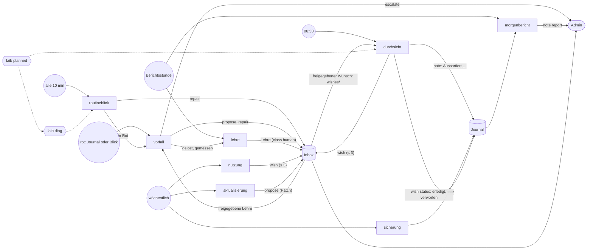

# The Operator's skills — who triggers what, what it leaves, who reads it

A skill is a folder under `skills/`: `skill.yml` (trigger, tools, prompt,
where the model decides) and, where steps must always happen, one `run.py`
(ADR 0023, its amendments #839 and #978). This page is how the eight play
together; each `skill.yml` says the rest. The README's table
(`scripts/architektur.sh`) lists them with their lines.

Solid arrows are what a skill leaves and who reads it; dotted ones are the
kernel's answers the skills read (one source, below).

| Trigger | Skill | Produces | Read by |
|---|---|---|---|
| every tick | `routineblick` | a `watch` note when something changed; one `repair` proposal per diag finding that offers one; a red goes to `vorfall` | the Box page; the owner in the Inbox |
| a red: a journal line the kernel posts, or a red the look sees first | `vorfall` | first aid (its script: the service's last real error line, the restart diag offers, diag again), then the model: restart, `propose`, `repair`, `escalate`; an `incident` note | the owner (an incident note reaches the webhook); `lehre` |
| daily, 06:30 | `durchsicht` | a `watch` note: the error patterns, and once „Aussortiert, kein Wunsch: …“; at most three wishes; the status of the Operator's open log wishes (`laib wish status`) | the owner in the Inbox; `morgenbericht` |
| daily, report hour | `morgenbericht` | the `report` note: the night, red first, and the lines its script always adds (the rate of the Operator's proposals, a lesson that keeps failing, due Box-Aufgaben, the model's day, durchsicht's „Aussortiert“, the wishes closed) | the owner: the Box page and the morning message |
| daily, report hour | `lehre` | a lesson per solved incident, `lessons/<probe>-<service>.md`, a class-human proposal | the owner in the Inbox; once let in, every session's context and `vorfall`'s first aid |
| weekly, Monday | `nutzung` | at most three wishes from the family's usage; a `watch` note | the owner in the Inbox |
| weekly, Saturday | `aktualisierung` | at most three patch proposals with their reason; a `watch` note | the owner in the Inbox |
| weekly, Sunday | `sicherung` | a note on the backup check and the canary restore | `morgenbericht` |

## A wish's way

A wish (`durchsicht`, `nutzung`) is a proposal adding `wishes/<time>.md`,
class human: only the owner lets it in. Once in, it stays in the state repo
with its status (`laib wish list`): **offen** until a hand closes it
**erledigt** or **verworfen**, with the reason, when and who, in the file
itself (#978). `durchsicht` re-checks the Operator's open log wishes a day
after they were filed: no error line of their services → erledigt;
only lines today's checks drop → verworfen („würde heute nicht gemeldet:
…“). The morning report says once what was closed; the Inbox's „Zuletzt
entschieden“ shows it. The status lives with the wish in the state repo,
not in a ticket.

## One source for a box fact

What is true of the box is the kernel's, read through a verb, never
decided again in a script (#978). „Is this stop planned?“: every action
that stops or starts services on purpose announces itself before it acts
with a maintenance marker — what it acts on, their dependents, until when —
and clears it at its end. While it holds, diag shows their reds as
expected, so `routineblick` and `vorfall`'s intake leave them alone, and
`durchsicht` drops the lines in its window; `laib planned <service>`
returns the markers, what the service depends on and its findings. A
marker not cleared by its until is a red finding of its own — only then
does `vorfall` analyse.

## The size rule

One file, one theme, at most 220 lines: a skill's `run.py`. What two
skills share lives in `skills/lib/` (`logzeilen.py`: how a journal line is
read and whether it is a real error) or in the scripts' door,
`skills/laibskill.py` (the channel, `when`, `hm`, `field`). A second file
in a skill's folder is a warning sign that its theme is two; `scripts/loc.sh`
warns on it and fails a file over 220 lines.
