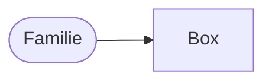
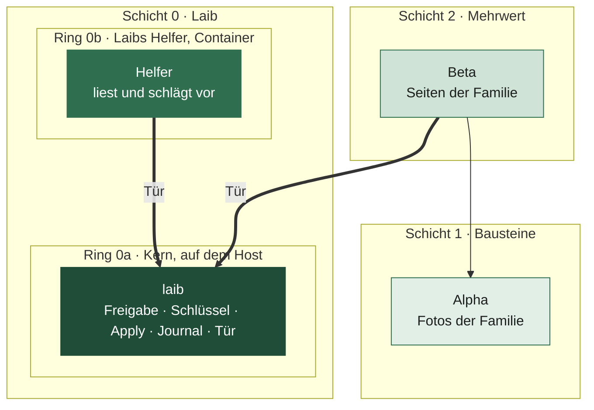
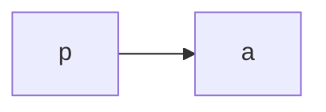
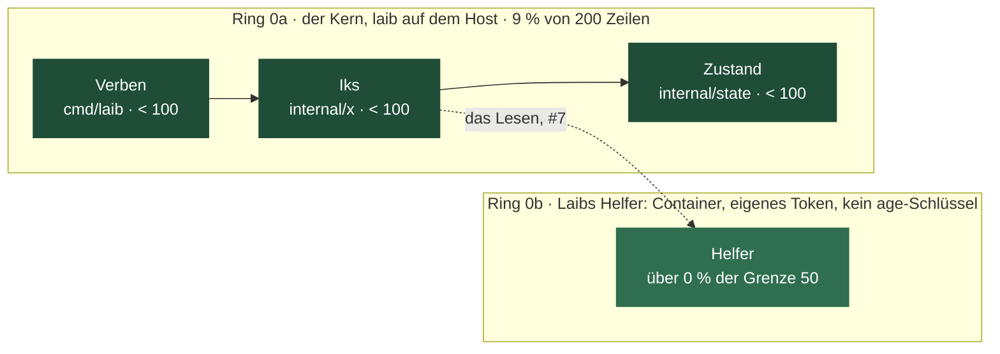
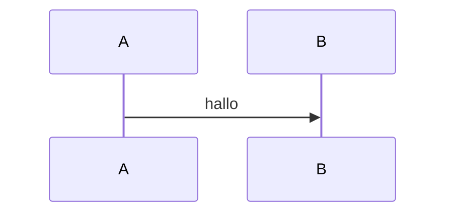

# Laib in C4

<!-- erzeugt von scripts/c4.sh aus docs/c4.yml, templates/*/laib.yml, internal/, cmd/laib und scripts/loc.sh; ändere die Quellen, nicht diese Datei -->

Eine kleine Box.

## Ebene 1 · Umfeld: wer mit der Box spricht

Nur ein Bild.

## Ebene 2 · Container: die Dienste der Box und wer wen braucht

Jede Vorlage in ihrer Schicht (`docs/c4.yml`), die Pfeile aus ihrer `laib.yml`: durchgezogen `after:` (startet nach), gestrichelt `uses:` und `instances:` (spricht mit), doppelt die Tür zu Laib (`needs: [mcp]`, Laibs Helfer). Abhängigkeiten zeigen nur nach unten (ADR 0035).

| Dienst | Schicht | Was | startet nach | spricht mit |
|---|---|---|---|---|
| [Alpha](../templates/a/) `a` | 1 | Fotos der Familie | — | — |
| [Beta](../templates/b/) `b` | 2 | Seiten der Familie | `a` | `a` |

## Ebene 2b · Haushaltsdaten: wessen Daten, wer liest, wer schreibt

Daten.

Regeln, die diese Karte trägt (Einzelheiten in `docs/DATA.md`):

- Eine Regel.

## Ebene 3 · Komponenten: Laibs Kern von innen

Die Pakete des Kerns mit ihren Importen (ohne die, die ein anderer Weg schon zeigt) und Laibs Helfer im Ring 0b; gestrichelt, was ADR 0035 aus dem Kern in den Ring 0b verlegt. Zeilen auf hundert gerundet, wie `scripts/loc.sh` zählt; genau stehen sie im README.

| Paket | Teil | Was | Zeilen | Zieht nach 0b |
|---|---|---|---|---|
| [`cmd/laib`](../cmd/laib/) | Verben | das Binary | < 100 | — |
| [`internal/state`](../internal/state/) | Zustand | laden | < 100 | — |
| [`internal/x`](../internal/x/) | Iks | ein Teil | < 100 | Helfer: das Lesen ([#7](https://github.com/mdopp/laib/issues/7)) |

## Ebene 4 · Fähigkeiten: was Laib kann

**Schützen**

- Hände mit Stufen

## Ablauf · Ein Ablauf

