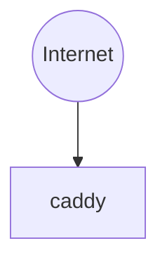

# Sicherheitskonzept der Box

<!-- erzeugt von scripts/c4.sh aus docs/sicherheit.yml, templates/, templates/hostnet.yml und internal/state; ändere die Quellen, nicht diese Datei -->

Wie die kleine Box schützt.

## Ein Grundsatz

1. **Nur nach unten.** Abhängigkeiten zeigen nach unten.

## Zonen und Grenzen

Eine Zone.

## Wer ist wer: Identitäten

| Wer | Wie erkannt | Darf | Stand |
|---|---|---|---|
| Familie | LLDAP | Homes | läuft |

### Hände und Stufen

Aus `internal/state` (die `policy.yml`, die `laib init` schreibt, und die Hände, die im Code feststehen). Stufen von unten nach oben: `read`, `propose`, `apply`; eine Hand darf bis zu ihrer Stufe, mit einer Verb-Liste nur diese Verben.

| Hand | Stufe bis | Verben | Pfade | Ablauf | Quelle |
|---|---|---|---|---|---|
| `human` | apply | alle bis zur Stufe | — | — | policy.yml |
| `ops` | apply | alle bis zur Stufe | — | — | policy.yml |
| `helper` | propose | `propose`, `note` | — | — | fest im Code |

Was die Box selbst anwendet (`autonomy:`, `auto`) und was ein Mensch freigibt (`proposal`); was die Inhaltsprüfung markiert (ein Skript auf der Box, eine öffentliche Adresse, `policy.yml`, ein Token, ein Host-Ordner), wartet immer auf einen Menschen:

| Klasse | Einstellung |
|---|---|
| `values` | auto |

## Wo man herankommt: Netz und Türen

| Weg | Schutz | Stand |
|---|---|---|
| Von außen | Caddy | läuft |

### Adressen

Jede Route jeder Vorlage, aus `templates/*/laib.yml`. „Heimnetz“ heißt zu Hause oder über das WireGuard des Routers; „von außen“ ist eine Entscheidung des Besitzers, eine Karte je Adresse.

| Adresse | Dienst | Schicht | Erreichbar | Anmeldung | Ausnahmen |
|---|---|---|---|---|---|
| fotos.&lt;domain&gt; | `a` | 1 | Heimnetz | Authelia, ein Faktor | nur Gruppe `family` |
| www.&lt;domain&gt; | `b` | 2 | von außen | Authelia, ein Faktor, von außen zwei | ohne Authelia: `/napi/` |

### Direkte Ports im Heimnetz

Ports, die ein Gerät zu Hause ohne Caddy erreicht (`ports:` mit `lan: true`); jeder andere veröffentlichte Port ist per nftables nur vom Host und den Containern erreichbar.

| Dienst | Port | Titel |
|---|---|---|
| `a` | 1000 | Alpha |

## Womit die Daten geschützt sind

| Daten | Liegen | Wer kommt heran | Stand |
|---|---|---|---|
| Fotos | in a | die Person | **Lücke**: unverschlüsselt ([#9](https://github.com/mdopp/laib/issues/9)) |

### Private Dienste

Aus `private:`, `oidc:` und `perPerson:` jeder `laib.yml` (ADR 0032; wer sich wo anmeldet: `docs/DATA.md`).

| Dienst | Private Daten | OIDC-Client | Instanzen |
|---|---|---|---|
| `a` | Einblick nur nach Freigabe, eine Stunde | — | — |

### Geheimnisse je Dienst

Nur die Namen, aus `secrets:` jeder `laib.yml`; die Werte liegen nur in `secrets.age` auf der Box. „Von außen“ heißt: ein anderer Dienst, Laib (ein Token für eine Hand) oder der Besitzer bringt es.

| Dienst | erzeugt die Box | von außen |
|---|---|---|
| `a` | `A_DB_PASSWORD` | — |
| `b` | — | `B_LAIB_TOKEN` (Token der Hand `b`) |

## Pro Schicht: was gilt

**Schicht 2**

- nur über die Tür

### Ausnahmen: Host-Netz und Label aus (#1166)

Jede Zeile `Network=host` und `SecurityLabelDisable=true` der Vorlagen, mit ihrem Grund aus `templates/hostnet.yml` (englisch, wie dort).

| Unit | Schicht | Art | Grund |
|---|---|---|---|
| `b/b.container` | 2 | Label aus | reads a's photos |

### Schicht 2 am Betriebssystem (#1245)

Was eine Vorlage der Schicht 2 heute noch an den Host bindet, gefunden in ihren Units: Host-Netz, Label aus, Capabilities, Geräte, fremde Ordner und Host-Pfade, Host-Units, die `podman exec` oder `podman run` aufrufen. ADR 0035 erlaubt nichts davon; die Liste steht hier, bis sie leer ist.

Je Vorlage: `b` 3.

| Dienst | Unit | Bindung |
|---|---|---|
| `b` | `b-refresh.service` | Host-Unit mit podman |
| `b` | `b.container` | fremder Ordner `${DATA_DIR}/a` |
| `b` | `b.container` | Label aus |

## Was passiert, wenn …

| Fall | Was die Grenzen bewirken |
|---|---|
| b wird übernommen | nur bs Hand |

## Offene Punkte

**Platte verschlüsseln** · geplant ([#9](https://github.com/mdopp/laib/issues/9), [archiv#3](https://github.com/mdopp/archiv/issues/3))

- noch offen
